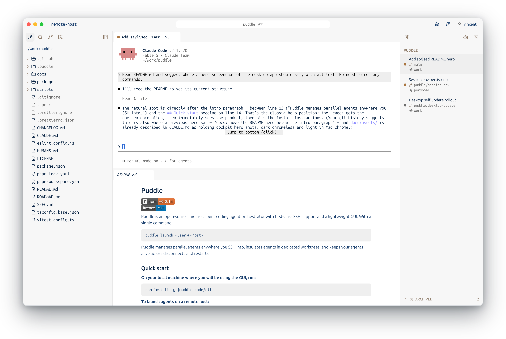

# Puddle

[](https://www.npmjs.com/package/@puddle-code/cli)
[](LICENSE)

Puddle is an open-source, multi-account coding agent orchestrator with first-class SSH support and a lightweight GUI. With a single command,

```bash
puddle launch <user>@<host>
```

Puddle manages parallel agents on local and SSH hosts, isolates work in dedicated worktrees, and retains conversations and workspace state across reconnects. Independently supervised runtimes in the 0.4.0 architecture preserve live processes across daemon replacement; hosts with limited session lifetimes have narrower guarantees below.

<p align="center">
  <picture>
    <source media="(prefers-color-scheme: dark)" srcset="docs/assets/cockpit-dark.png">
    
  </picture>
</p>

## Quick start

**On your local machine where you will be using the GUI:**

For a standalone installation without Node.js or npm, use your deployed app's
installer (replace the example host):

```sh
curl -fsSL https://app.example.com/install.sh | sh
```

The CLI also includes `pudl`, which runs puddlang programmes for coder/reviewer
loops and other agent workflows through the shell or stdio MCP. See the
[puddlang guide](docs/puddlang.md) for setup, examples and initial limitations.

This installs the CLI under `~/.local/share/puddle/cli` and its launcher at
`~/.local/bin/puddle`. Add `~/.local/bin` to your `PATH` if the installer asks.
The standalone releases support Linux x64/arm64 and macOS arm64. The script and
checksum-verified archives are also attached to this repository's GitHub Releases.
An optional `--version` selects a release; `--prefix` and `--bin-dir` select the
installation and launcher directories:

```sh
curl -fsSL https://app.example.com/install.sh | sh -s -- --version X.Y.Z
```

Alternatively, with Node.js already installed, use npm:

```sh
npm install -g @puddle-code/cli
```

**To launch agents on a remote host:**

```sh
puddle launch <user>@<host>
```

This connects Puddle to the remote host over SSH, bootstrapping the Puddle daemon on first contact and enabling you to begin development.

**To connect from a phone or another browser over the internet:** deploy your own
[mobile access service and trusted web application](docs/mobile-access.md), then
use `puddle remote enable --profile <profile-id>` and `puddle remote pair --profile <profile-id>`. Each profile registers independently. The host connects outward;
there is no public daemon port or VPN requirement. Each browser needs explicit
host approval. The phone view provides live terminals, prompt input and read-only
text/diff review over a pinned Noise connection through the relay.

Puddle works using your system `ssh`, so `~/.ssh/config`, agents, and jump hosts apply.

**For development on your own machine:**

```sh
puddle launch
```

This installs the Puddle daemon under `~/.puddle` and serves the GUI at `http://localhost:7433`.

Ctrl-C normally closes only the GUI while independently supervised runtimes keep running.
Some SSH hosts require a cockpit-held daemon. Closing that cockpit stops the daemon and
detaches its independent owners; host policy may retain or reap those host-session runtimes.
Reconnection adopts survivors and restores interrupted sessions according to the host's
auto-resume setting. These limited hosts do not support managed updates without a usable
service manager.

The [deployed app](docs/mobile-access.md#host-the-installer) serves `/install.sh`
as the single public installer. Install daemon and desktop components through
`puddle install daemon [user@host]` and `puddle install desktop`. A first
`puddle launch user@host` still installs a missing daemon automatically from
GitHub Releases.

**Managing components:**

The CLI manages the daemon, runtime software, desktop app and itself, with optional versions and SSH targets:

```sh
puddle upgrade                            # everything installed → the newest release
puddle install daemon@v0.0.32 user@host   # pin a host's daemon to a version
puddle upgrade runtime user@host          # select the default build for future runtimes
puddle updates user@host                  # inspect the host's current update operation
puddle remove daemon                      # uninstall; your data stays unless you --purge
```

Runtime install/upgrade requires a running daemon with host-update support (application protocol 25.7+) and an available user service manager. Existing runtimes retain their pinned build. `puddle updates --operation <id> --cancel` abandons an exact preparation before dispatch; accepted work is observed without replay.

**Desktop app (optional):**

The same cockpit also ships as a standalone desktop app — identical UI and engine, plus a File → "Connect to SSH Host…" menu for remote hosts. Install it with `puddle install desktop` (macOS arm64 or Linux x64). Once installed, it runs independently of the CLI.

An installed Puddle CLI manages the desktop app directly: quit Puddle, then `puddle install desktop`, `puddle upgrade desktop`, or `puddle remove desktop`. On macOS a fresh install goes to `/Applications` when writable, otherwise `~/Applications`; on Linux `install desktop` asks where to put the AppImage (default `~/puddle`) and opens the folder — later updates happen from inside the app.

**Host requirements**: Linux with glibc 2.28+ (Ubuntu 20.04+, Debian 11+, RHEL/Rocky 8+;
Alpine is not supported) or macOS, with `git` and `curl`, plus whichever agent CLIs you want on
`PATH`. Standalone CLI installs include Node and require no npm; npm installs require Node 22+. The client side works from any OS with a browser and `ssh` (Windows works, with repeated
auth prompts unless you use a key).

## How it works

- **Puddle separates host management from live execution.** First connection installs a missing daemon on a supported local or SSH host. In the 0.4.0 architecture, `puddled` manages worktrees and application state, while one independent `puddler` per runtime owns agent and shell PTYs and provider sidecars. Supervised owners survive daemon replacement and cockpit disconnects. After machine reboot, saved conversations can resume according to host settings; live process state does not survive reboot. Hosts without a usable service manager retain the limited host-session fallback described above.
- **Puddle orchestrates parallel isolated agents** each working in a unique git worktree and branch. You can choose the branch and worktree during session creation.
- **Puddle's lightweight GUI** allows you to track agent progress, session usage, and active worktrees.
- **Puddle's philosophy is that any good developer must stay grounded in their code.** Puddle natively integrates live terminals, file editing in Monaco, git commit grahps, diff views, and opens worktrees in your favourite IDE.
- **Multiple profiles and accounts** enable several collaborators to collaborate on a shared remote host. Puddle manages multiple accounts per agent type and profile, symlinking conversation histories so you can run from multiple Claude Code accounts at once and move your conversations between each.

```
 client machine                          host machine (local or remote)
┌──────────────────────────────┐        ┌───────────────────────────────────┐
│ browser ── localhost:7433     │        │ puddled                           │
│               │              │ local: │   ├─ REST + WS API                │
│ puddle CLI ◄───┘              │ direct │   ├─ runtime controller           │
│   ├─ static web UI assets     │───────►│   ├─ worktrees + SQLite           │
│   └─ /api + /ws proxy         │ remote:│   └─ daemon-owned execution       │
└──────────────────────────────┘ ssh -L └───────────────────────────────────┘
                                                        │ private IPC
                                        ┌───────────────────────────────────┐
                                        │ puddler (one owner per runtime)   │
                                        │   PTYs, sidecars, output, journal │
                                        └───────────────────────────────────┘
```

The CLI serves the UI at a stable local origin and reverse-proxies the API to the daemon, directly in local mode, through the tunnel in SSH mode. The daemon is headless and host-agnostic on `127.0.0.1:7434`. UI updates ship with the CLI. Compatible cockpit and daemon releases may differ; the launcher requires approval when an older application protocol is incompatible. Explicit daemon/runtime updates also use the CLI or supporting cockpit Host settings. Review distinguishes unaffected independent runtimes from work requiring interruption; first upgrades from daemon-owned sessions report their interruption count. Declining leaves the daemon running. `--no-upgrade` refuses before prompting, and non-interactive launches require an explicit `puddle upgrade daemon [user@host]` first. Short-lived host connection leases, separate browser authorisation and exact cockpit Host/Origin checks guard local access. Launch invitations are single-use; browser login survives cockpit restarts, while forwarded applications use a separate loopback origin. After upgrading from the old token flow, run `puddle launch` once to authorise existing tabs.

Everything lives under `~/.puddle` on the host, installed without sudo — and `puddle remove daemon` takes it apart again.

## Development & teardown

**UI preview without a daemon.** Run `pnpm --filter @puddle/web dev:preview` and open <http://localhost:5174>. The real cockpit opens a sample project with coloured file icons, expandable folders and editable sample files. Appearance settings work normally. Sample saves last until reload; terminals, agents and host operations are unavailable. This mode uses browser-only fixtures, has no host gateway and is excluded from production builds. The sample `examples/` folder includes a notebook and PDF; Search, Changes, Worktrees and ended sample sessions exercise the navigator layouts. With the preview running, `pnpm --filter @puddle/web test:preview` checks the sample screens, repeated editor resizing, whole-pane dragging and inline diff close controls in Chromium. Use `pnpm --filter @puddle/web dev` to work against a compatible local daemon instead.

**One daemon, many clients.** There is a single local daemon per machine, living under `~/.puddle` and run by one supervised service (launchd's `dev.puddle.puddled` on macOS, systemd's `puddled` on Linux). The global `puddle` and a repo-run `node packages/cli/dist/index.js` are **both just clients** that talk to — and, when needed, install — that same daemon. Multiple clients can share that daemon; there is no automatically separate "dev daemon" alongside a "production daemon".

**Dev build vs. production.** The standalone installer or `npm i -g @puddle-code/cli` is the production path — its `puddle` fetches and upgrades the daemon from this repo's GitHub Releases. To exercise uncommitted changes, build and run from the repo:

```sh
pnpm build && pnpm build:tarball
node packages/cli/dist/index.js upgrade daemon@X.Y.Z --tarball dist-release/puddled-vX.Y.Z-PLATFORM-ARCH.tar.gz
node packages/cli/dist/index.js launch --foreground
```

Replace `X.Y.Z`, `PLATFORM` and `ARCH` with the version and target printed by `build:tarball`; keep the generated `.sha256` file beside the archive. Add `user@host` after the component for an SSH target. A modern stopped installation starts its selected service before an explicit upgrade; `launch --tarball` alone does not replace that selected build. A compatible running daemon also ignores the launch tarball. To select the same archive for future runtime launches, use `upgrade runtime@X.Y.Z --tarball …`; existing owners remain pinned until explicitly restarted. First installation and approved legacy transitions still use the embedded bootstrap. Both clients share the host's daemon and cockpit registry. Never launch the daemon from inside a coding-agent shell: it inherits the agent's environment and can break conversation resume; use a plain terminal.

**Kill.** `puddle kill --all` (or Ctrl-C in a `--foreground` run) normally stops the local cockpit
UI only; a supervised daemon and its sessions keep running. When launch reported that it is keeping
the daemon attached over SSH, killing that cockpit stops the daemon. Host-session owners may
survive or be reaped by host policy; the next launch adopts survivors and reconciles ended
owners according to the host auto-resume setting.
A supervised daemon is auto-restarting
(launchd `KeepAlive`, systemd `Restart=always`), so a plain `kill <pid>` bounces straight back — stop
it through its supervisor:

```sh
launchctl bootout gui/$(id -u)/dev.puddle.puddled   # macOS (launchd)
systemctl --user disable --now puddled              # Linux (systemd user unit)
kill "$(cat ~/.puddle/puddled.pid)"                 # nohup fallback (no supervisor)
```

**Restore published software.** Use a compatible CLI to explicitly upgrade to a chosen compatible published version: `puddle upgrade daemon@X.Y.Z` (and `puddle upgrade runtime@X.Y.Z` for future runtimes). Replace `X.Y.Z` with that release; compatibility and recovery checks still apply. Removing and reinstalling a modern daemon can restore its retained service and selected generation, so it is not a way to force a download. Existing runtime processes keep their pinned build until explicitly restarted.

**Uninstall.** Removing the CLI alone leaves the daemon installed and running — a full teardown is:

```sh
puddle remove daemon --purge   # stops the daemon, unregisters its service, deletes ~/.puddle
puddle remove cli              # standalone or npm removal, using its installation channel
```

> ⚠️ `~/.puddle` **is** your local state — the SQLite database with every profile, account, and session (plus conversation history), the daemon's worktree tracking, and the auth token. `--purge` deletes it irreversibly (the command lists dirty or unpushed worktrees and asks first); without it, `puddle remove daemon` keeps the data for a later reinstall.

## Licence

Puddle is licensed under the [MIT License](LICENSE). Copyright (c) 2026 Yiding Song.
