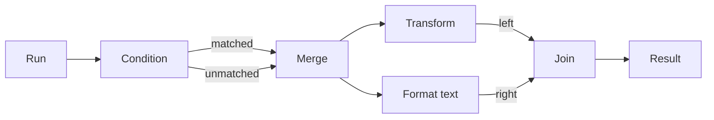

# Huddle data flow

On application 28.25+, **Add node** offers five editable flow templates. Each
creates ordinary `node.json` and TypeScript files under the huddle's `nodes/`
directory. Select a node for settings or **Open script** to edit its behaviour.
Save and validate the graph before explicitly starting or applying it.

| Node | Behaviour |
| --- | --- |
| Transform | Initially returns `value` as `completed`. Edit its script to map data and update the input/output schemas to describe the result. |
| Format text | Produces a string using `{{input}}` or `{{input.field}}`. Strings stay text; other values become JSON. Missing fields fail. The shared agent-prompt formatter bounds the result to 128 KiB. |
| Condition | Selects a field using a JSON array of names/indexes, then compares it with **Equals**. Sends the original input to either `matched` or `unmatched`. |
| Merge | Forwards either `left` or `right` as `completed`, once per arriving alternative. It does not wait for both or deduplicate them. |
| Join | Waits for `left` and `right` from the same execution and activation, then emits `{left, right}`. |

Condition defaults to path `["complete"]` and comparison value `true`, suitable
for a structured review reply. Use `[]` to compare the whole input. Values are
compared without coercion: `"true"` differs from `true`, object key order does not
matter, and array order does. A missing field fails the invocation; it does not
silently choose `unmatched`. Both outputs are optional completion ports, and only
the selected branch receives a value.

Use Merge to bring mutually exclusive branches back together. If both inputs
arrive, Merge runs twice. Use Join after fan-out from a shared output: the owner
preserves that activation through ordinary completion outputs. Separate triggers,
independent event emissions and distinct feedback rounds cannot be joined merely
because they have produced recent values. A Join with a missing branch does not
invent one.

The authoring kit includes `examples/flow.json`:



Read it with `pudl huddle authoring examples/flow.json`; the command returns the
asset as JSON with a `content` field. Copy the referenced `transform`, `format-text`,
`condition`, `merge` and `join` template directories into `nodes/`, and replace
the example id with the huddle's directory id. The example configures Format text
as `Message: {{input.message}}`. Run with:

```json
{ "complete": true, "message": "Ready" }
```

Result receives:

```json
{
  "left": { "complete": true, "message": "Ready" },
  "right": "Message: Ready"
}
```

Changing `complete` to `false` takes the other branch and still continues once.
The files can be edited by any selected authoring agent. None of these templates
starts an agent or touches a worktree; components that add file/session operations
must declare those capabilities and their explicit worktree bindings.

Loops remain explicit bounded feedback connections with finite round, turn and
time limits. Flow nodes use the same scheduler, immutable inputs, durable output
routing and execution budgets as other scripts. Saving a template or graph never
activates it.
