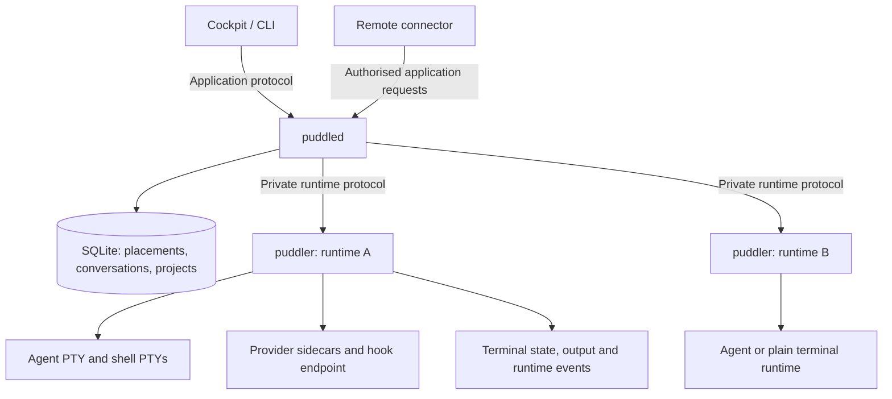

# Persistent runtimes and cockpit-managed host updates

Release target: **0.4.0, standard behaviour for all users**. Persistent runtimes
and cockpit-managed host updates are required release functionality. There is no
enable/disable setting or user-selectable legacy backend. Host lifetime limitations
must be reported honestly; internal fixture configuration is not a product toggle.

Implementation status, 2026-11-04:
Default daemon launches now use independent runtimes, resolving the installed
runtime selector and checking the host service manager before launch intent. The
legacy composition is restricted to internal migration fixtures. Hosts without a
usable systemd/launchd manager currently refuse new launches; detached/attached
lifetimes remain a release blocker. The daemon coordinator now composes maintenance
for private host-control daemon updates. Explicit CLI recovery continuation now works
through private authority or the trusted offline local/SSH helper. Ordinary CLI daemon
upgrades now share runtime updates' staging, review and observation path, with explicit
interruption approval for daemon-owned work. Launchers now start the selected installed
service without reinstalling it; explicit upgrades on stopped hosts restore that
coordinator first. Local/SSH cockpit routes now share preparation, review and explicit
activation/recovery through the existing host coordinator. Host version inventory and
coalesced, cached release discovery now feed that gateway. Settings → Host now exposes
preparation, exact impact approval and live recovery, with per-window release offers.
Individual runtime inspection/restart is available in local/SSH session menus.
Cockpit status now reads and labels recorded operations while the daemon is unavailable.
Explicit offline continuation now uses a participating trusted helper and pinned
recovery dispatcher. Legacy cockpit transition, remaining failure recovery and
complete packaged upgrade acceptance remain unfinished.
This document describes the intended refactor; [SPEC.md](../../SPEC.md) continues
to describe shipped behaviour. Update the specification, protocol documentation,
repository instructions and changelog alongside each implementation phase.

The delivery order is process continuity first, local/SSH cockpit updates second,
then relay maintenance and default rollout. The primary acceptance journey is:
open a host window, receive an update offer, apply the daemon/runtime software
update, reconnect, and observe the same running agent and shell processes. A
second newly created runtime uses the updated build while the original runtime
continues using its pinned build. Repeat this with a compatible cockpit on a
different release to verify that release equality is never an upgrade condition.

See [outcome and decisions](#outcome-and-decisions) for the agreed scope,
[implementation sequence](#implementation-sequence) for phased deliverables and
[acceptance matrix](#acceptance-matrix) for the release gates.

Implementation evidence so far (newest first; earlier entries record their milestone limitations):

- Explicit continuation now supports confirmed connector-start loss through the
  existing recovery worker and service helpers. A private accepted fingerprint binds
  the approved connector service and selected daemon generation after positively stopped
  service, ended outgoing PID and absent manager checks. Execution repeats this evidence
  before startup, including after a rate-limit reset. An observation-only job cannot
  acquire restart permission later; healthy replacements are observed without another
  start, and consumed jobs never repeat. Deterministic tests cover changed authority,
  configuration and selection, live/unavailable managers, start limits and lost replies.
  No network protocol changes are required. Real connector/supervisor upgrade acceptance
  and loaded-idle launchd recovery remain open.

- Explicit selected-service startup and accepted replacement recovery now handle
  systemd start limits through the shared stopped-service inspector. Only a confirmed
  stopped exact unit with `Result=start-limit-hit` is reset; changed definitions,
  ambiguous state and lost reset replies prevent startup. Recovery records start intent
  before reset, retains controller exclusion and repeats current database/runtime checks
  immediately before dispatch. Fixtures cover failed/inactive limits, changed evidence,
  lost replies and consumed recovery attempts. No protocol changes are required. Actual
  Linux service acceptance, loaded-idle launchd recovery, connector-start recovery and
  abrupt-kill installer-lock repair remain open.

- Application 25.17 adds explicit disconnected-cockpit continuation through the
  selected local/SSH helper, reusing the existing private envelope, correlated
  requests and pinned recovery worker. Supporting staged metadata is required;
  older candidates cannot fall back to uncontrolled dispatch. Browser cancellation,
  connection changes and helper input/signals revoke pending participation, which
  the existing dispatcher rechecks before durable acceptance. Accepted jobs retain
  independent execution; repeated exact requests only observe recorded acceptance.
  No daemon lease or relay grant is issued. UI recovery is a separate explicit action,
  with mutation retries/queuing still disabled. Built local/simulated-SSH helper tests
  exercise cancellation before dispatch and after recorded acceptance, lost replies,
  exact-request deduplication and older staged metadata. Real coordinator tests use
  fake supervisor outcomes to check both sides of acceptance; HTTP tests cover logout,
  Origin and reconnection, and channel tests reject malformed/duplicate input. Chromium
  exercises explicit offline recovery and lost-reply observation without repeating its
  POST. Platform/provider upgrade acceptance,
  legacy transition and the remaining recovery/lifetime/removal gates remain open.

- Application 25.16 adds recorded operation inspection to disconnected local/SSH
  cockpits through the existing trusted helper. Browser authority is checked before
  and after inspection; aborted requests and connection changes discard the reply.
  Public projection omits private stage/worker evidence, while Settings labels the
  last connected daemon version and recorded status/time without claiming current
  service health or adoption. Offline mutation capabilities stay disabled, and no
  failed live mutation falls back to the helper. Focused tests cover no-daemon reads,
  corruption, historical selection, browser revocation and connection races. Built
  helper tests exercise isolated local/simulated-SSH inspection without SQLite or
  service startup. Chromium verifies recorded progress/completion labels, disabled
  mutations and a return to live status through the authenticated status socket.
  Source/changed-test typechecks, lint and web/CLI/desktop builds passed. These are
  inspection and UI checks, not actual supervisor/provider upgrade acceptance.
  Explicit offline continuation,
  legacy transition and packaged platform acceptance remain required.

- Application 25.15 adds placement-scoped inspection and explicit selected-runtime
  restart, with controls beside session actions. `sessions/runtime/` composes existing
  control queues, clean-exit observation and exact conversation resume. Review binds
  owner/placement/native ref, shell generations and selected immutable release; authority
  and selection are checked again before launch intent. Isolated real-owner tests reject
  changed shell inventories and repeated approvals, replace only the selected runtime
  with an installed 0.4.1 build, and preserve a neighbour's 0.4.0 process. A fake-agent
  test resumes the exact post-switch native ref without an onboarding prompt. Failure
  fixtures cover revoked authority, changed selections and archive races. The browser
  inspector lists the affected terminals and observes a lost reply without repeating
  restart. Native providers, actual platform services and remote access remain separate
  acceptance/integration gates; no runtime or remote protocol changes were made.

- Local/SSH Settings → Host and shell offers now share a status query and host WS
  invalidations. The borderless controls show current/default builds, grouped existing
  runtimes, timestamped release checks, separate preparation/review/apply and supported
  live recovery. Approval matches the displayed operation revision and exact interruption
  inventory; mutation retries and offline queuing are disabled. Window offers compare
  each component independently and survive React remounts without resurrecting dismissal.
  Focused tests cover these boundaries, including remote exclusion. An isolated Chromium
  fixture exercises the real components against simulated host replies: remount while
  preparing, explicit interruption approval, lost apply reply without replay, and
  dismissed/new-release/new-window offers. It does not establish packaged host continuity.
  Individual runtime controls, offline/legacy cockpit recovery, relay maintenance and
  the platform/provider release gates remain open. No protocol changes in this increment.

- Application 25.14 adds opt-in catalogue metadata to private status and the cockpit
  gateway: running daemon, selected runtime default, bounded build counts and cached
  latest-stable discovery. One lazy host poller retains the 30-minute cadence and
  timestamped last-known results across daemon replacement, using shared CLI/desktop
  lookup/version helpers. Host archives embed their publishing repository; cockpit
  staging uses that host source through the existing installer. Discovery checks asset
  availability but performs no download, activation or runtime restart. Host-only
  invalidations notify status subscribers while profile leases remain excluded. Tests
  cover concurrent readers, replacement/offline cache behaviour, source changes, bounded
  metadata/inventory, shutdown and failed persistence. An isolated empty daemon proves
  the production control path and cache reuse after restart; HTTP release responses are
  mocked, not evidence of published-archive/provider continuity. Settings UI, per-window
  offers, offline cockpit recovery and remaining release gates are still required.
  The actual release script also built and smoke-tested an isolated 0.4.0 host package
  with the publishing repository embedded; this verifies packaging, not an upgrade.

- Application 25.13 adds the local/SSH cockpit update gateway, wired into CLI,
  desktop and Vite composition. Preparation reuses the CLI staging helper; review,
  exact approval, cancellation and live recovery use the existing host coordinator.
  Strict browser schemas omit private commands, receipts, transport selection and
  filesystem inputs; replies project bounded state without stage/worker evidence
  or private blocker paths. Mutations use cancellable existing host-control channels
  tied to browser and parent cockpit authority. Isolated HTTP/private-control tests
  cover Origin/authentication, release skew, older capabilities, read access during
  mutation, staging revocation, exact interruption consent, changed reviews, logout
  before dispatch and lost apply replies without replay. The coordinator/SQLite and
  lease boundaries are real; stages and supervisor outcomes are simulated. Settings
  UI, inventory/release discovery, update offers, offline cockpit recovery and packaged
  provider/platform acceptance remain required. Remote 4 and runtime 1.0 are unchanged.

- Launcher startup now invokes a fixed trusted `--start-daemon` mode in the selected
  pinned host updater. `host/startup/` shares supervisor inspection/configuration checks
  with updates, retains controller/update/installer exclusion, verifies the selected
  release and loaded systemd executable, and issues one start/bootstrap without rewriting
  services, selectors or controller identity. A dispatched incomplete update requires
  explicit recovery; an undispatched preparation remains available after normal startup.
  Completed workers still require ended-lifetime evidence. Local/SSH launch and explicit
  stopped-host upgrades share authenticated readiness, observing lost replies without
  retry or legacy/attached fallback. Approved legacy launcher upgrades now use the shared
  upgrade entry. Fixtures cover release skew, exclusion, changed configuration, wrong
  executables and lost replies. A real bundled helper with a scripted systemd command
  proves pinned invocation and SIGHUP cleanup; native supervisor/provider continuity is
  not established by these tests. Loaded-idle launchd jobs, systemd start-limit recovery,
  abrupt SIGKILL/stale installer-lock repair and complete packaged startup/upgrade
  acceptance remain required. All three protocols are unchanged.

- Ordinary daemon install/upgrade commands now use the existing host coordinator
  on hosts advertising private updates. Runtime and daemon application share
  `cli/src/lib/installation/host/apply.ts` and `upgrade.ts`; no separate installer or
  polling loop was added. Exact interruption consent comes from a shell-owned callback,
  rechecking participating authority after the prompt and retaining host-side final
  impact checks. Missing/declined consent leaves the stage unactivated. Lost apply
  replies cause observation only. An unavailable modern installation or failed inspection
  cannot fall back to the legacy installer; first installs and legacy transitions keep
  the embedded bootstrap. CLI/private-control fixtures cover local/SSH daemon updates,
  changed impact/authority, missing consent and lost replies alongside existing runtime
  and legacy launcher tests. Supervisors and activation outcomes are simulated here;
  packaged upgrade acceptance, stopped modern-host startup, launcher integration and
  cockpit controls remain required. All three protocols are unchanged.

- Application 25.12 adds `puddle updates [user@host] --operation <id> --continue`,
  reusing the independent recovery dispatcher online and the existing OS/SSH bootstrap
  helper offline. The offline helper validates passive staged metadata and pinned
  executables, invokes the exact operation revision once and inspects durable acceptance
  even if the worker reply is lost. Shared readers now live under
  `shared/src/node/installation/`, with mutation/recovery logic retained in the daemon.
  Opted-in status replies expose only recovery ids, revisions and consumption; these
  are recorded evidence, not proof of current liveness or completion. Older status
  clients retain their reply shape. Private-control fixtures cover authority loss and
  lost dispatch replies; built local/SSH helper fixtures cover offline acceptance,
  exact-request deduplication and invalid staged executables/metadata. These tests use
  simulated supervisors or deterministic workers, not packaged service upgrades.
  Cockpit continuation, ordinary CLI/launcher activation, remaining connector recovery
  and complete platform acceptance remain required. Remote 4 and runtime 1.0 are unchanged.

- Internal recovery can now authorise a fresh daemon start after confirmed service
  loss, including inactive or failed systemd services with no main process. It holds
  the existing controller claim without changing its epoch, reads committed SQLite
  WAL state through a read-only connection, and checks the candidate against current
  schema/runtime records as well as the original shutdown checkpoint. The accepted
  attempt binds controller, selected builds, installed runtime default, schema and
  owner inventory; execution and the final pre-start check repeat that inspection.
  Recovery never migrates or restores application data. Retained restart owners
  extend fresh adoption requirements, so runtimes created after the original
  checkpoint cannot disappear from completion proof. Isolated live-owner tests cover
  unchanged shell/controller identities, WAL-only migrations, later runtime launches
  and fresh private-authority adoption of additional owners; service supervision is
  simulated. Still required: packaged crash/start-limit recovery, failed connector
  starts, stopped/unmanaged installations, any explicitly permitted rollback, and
  public CLI/cockpit continuation. The restart evidence is private worker state;
  application 25.11, remote 4 and runtime 1.0 remain unchanged.

- Explicit recovery now continues across executed attempts, merging every retained
  step journal and checking each accepted evidence fingerprint. A later early
  failure cannot erase an earlier selection or start attempt. Recovery after a
  daemon start requires fresh adoption and the unchanged service configuration;
  the replacement keeps its controller and is never stopped or started again.
  An unattempted connector start requires positively stopped service/process
  evidence; an attempted start must already verify as a healthy replacement.
  The command runner rechecks operation and current adoption before each command.
  Tests cover repeated partial failures, damaged journals, lost connector replies
  and changing authority. An isolated live owner/private-authority fixture checks
  running continuation with the same controller and shell PID; supervisor commands
  and packaged upgrades still require platform acceptance. Crashed replacements,
  failed attempted starts, stopped/unmanaged installations and public CLI/cockpit
  continuation remain unfinished. None of the three protocols changes.

- The host updater now has a pinned, independently supervised recovery-worker
  entry for the stopped-daemon path. Trusted host invocation can dispatch an exact
  operation revision once; accepted replies are inspectable after connection loss.
  A bounded ledger retains all attempts and their pre-command process groups, with
  pending-job fencing and descendant checks shared by completion recovery and
  maintenance release. The worker reuses shutdown claims, journal writing, the
  canonical installer, service startup and fresh completion verification. It can
  execute unattempted selections after shutdown, verify attempted selections without
  replay, then start the recorded daemon/connector services. Unit fixtures cover
  consumed dispatch, ordering and lost replies; a real process test retains exclusion
  while a command child outlives its recovery worker. Supervisor/installation and
  fresh adoption are simulated in the new composition fixtures, so packaged upgrade
  acceptance is still required. Public CLI/cockpit integration, recovery after an
  attempted daemon start, and further continuation after an executed recovery attempt
  remain unfinished. None of the three protocols changes.

- Shutdown observation now shares one hand-off verifier between ordinary updates
  and internal stopped-daemon recovery. It rechecks the original service definition,
  exact checkpoint and released controller without minting another epoch or sending
  another stop. Recovery shares completion recovery's dispatch/execution exclusion,
  checks ended-worker evidence and attempted-step intent, and retains controller
  exclusion after checking candidate database/runtime support. An isolated daemon
  test loses the stop reply, rejects incompatible runtime support and recovers the
  hand-off while the independent shell retains its PID; failure tests cover missing
  evidence, changed controllers/configuration and authority/lifetime races. This is
  the internal recovery hand-off, not yet a public forward-recovery action: separate
  recovery-worker dispatch, remaining selection/start steps and offline CLI integration
  remain required. Application 25.11, remote 4 and runtime 1.0 are unchanged.

- The surviving worker now writes a bounded step journal before activation,
  binding its fixed stop/select/start plan to the accepted operation and worker.
  Every step records durable intent before external mutation; lost replies and
  failed completion writes retain uncertainty without repeating the step. Later
  planned steps remain distinguishable from attempted ones. Existing installer,
  service replacement and completion verification paths are reused. The journal
  tests cover failures before/after durable writes, lost replies, exact ordering
  and controller-claim release after shutdown when journal completion fails.
  Installer transaction fixtures verify runtime-only, daemon and combined plans.
  The journal
  is recovery evidence, not permission to continue or proof of component health;
  supported forward recovery still needs implementation. Older missing journals
  cannot establish that a command never ran. All three protocols are unchanged.

- Local/SSH `puddle updates` now falls back to the existing bootstrap helper when
  daemon authority cannot connect. It reads the bounded private operation ledger
  using the same schema and stage-digest validation as the daemon, without opening
  SQLite, starting services or replaying updates. Recorded status is labelled;
  cancellation, recovery and fresh adoption requests cannot use this fallback.
  Built CLI fixtures cover local and simulated SSH inspection with no daemon or
  database, and shared tests cover legacy permissions, unsafe paths and corrupt
  evidence. Application 25.11, remote 4 and runtime 1.0 remain unchanged.
  Offline recovery mutations and forward recovery remain required.

- Application 25.11 exposes explicit completion recovery through local/SSH private
  control and `puddle updates --operation <id> --recover`. It fences the original
  dispatch under dispatch/execution claims, verifies the recorded worker group has
  ended, reuses fresh completion evidence and rechecks authority before committing.
  Workers record their own process group before activation; maintenance release now
  checks that group as well as execution ownership. A real process test leaves an
  installer child alive after its worker exits and confirms recovery stays blocked.
  Private control fixtures cover local/SSH CLI completion without another dispatch,
  older-host refusal, lost replies, incomplete selection and authority loss. These
  tests use metadata/supervisor fixtures, not full packaged service upgrades.
  Forward recovery, offline host integration and stopped/unmanaged connector handling
  remain required. Remote 4 and runtime 1.0 are unchanged.

- Completion verification now lives under `updates/verification/` and is shared by
  ordinary worker execution and recovery-phase inspection. It reuses exact selector,
  host-authority/adoption and connector checks, adds replacement daemon service/configuration
  corroboration, and rechecks operation/controller identity after asynchronous probes.
  Recovery inspection produces evidence without repeating installation, stop or start
  commands and leaves the operation unresolved. Tests cover lost replies, changed
  configuration, stale evidence and an independently running owner observed through
  private authority in recovery. Supported recovery commands, original-worker lifetime
  fencing and recovery with the daemon stopped remain required.

- Daemon builds now declare their existing SQLite migration ceiling in passive
  release metadata. Preflight rejects unknown/older schema support, includes the
  actual database version in approval and rechecks it after asynchronous probes.
  The worker compares its shutdown checkpoint before selecting a candidate.
  Startup refuses databases newer than this build before changing journal mode
  or writing application data, and closes failed handles. Runtime-default changes
  remain independent of daemon storage. This is existing migration evidence, not
  another protocol or rollback permission. Recovery inspection/actions and offline
  host-control integration still need implementation; no old data is restored.

- Production host control now supplies the full ordered maintenance composition,
  after boot reconciliation and auto-resume. Clients/upkeep/log retention drain
  before programme/compilation/catalogue/marker work, then launches, native
  observations/controls/notebook dispatch, notifications/service cleanup, discovery
  and finally reconciliation. Release reverses the order and refreshes account
  checks; accepted or uncertain dispatch retains the hold. Retention abandons
  temporary copies before replacement during the hold and cannot restart after
  shutdown. An isolated real daemon/control channel and independent shell verify
  admitted-request drainage, continuing in-memory execution, held database cursors
  and recovery catch-up. Service inspection/dispatch are simulated in this test;
  full packaged supervisor upgrades and supported recovery remain release gates.
  Long admitted builds/startup can still reject the bounded pause rather than be
  interrupted before approval. This adds no protocol change or user toggle.

- Application 25.10 adds an interruption fingerprint for supporting host-update
  clients, retaining `can_apply: false` until separate explicit consent. Apply
  rechecks the release/impact fingerprint under maintenance and requires matching
  interruption approval before consuming dispatch. Missing consent keeps the stage
  available; changed inventory or authority refuses dispatch and releases the hold.
  The pinned worker preserves matching consent. Older clients receive the original
  blocked shape, and newer clients refuse this field on older hosts. Production
  pause composition, client confirmation and recovery integration remain required;
  remote 4 and runtime 1.0 are unchanged.

- Programme and notebook maintenance reuse host admission. Independent programme
  prompts release admission after their single dispatch, while result observation
  continues; later runner RPCs wait within the existing operation bounds and are
  discarded on shutdown. All runners are aborted before shutdown yields, preserving
  accepted independent turns. Cancellation also waits for admission. Notebook
  startup drains through cell/request dispatch while submitted cells continue and
  kernels remain in interruption inventory. Tests separate startup, dispatch and
  completion, including an actual delayed fake-provider owner and a real Jupyter
  kernel retaining state. Long programme startup and compilation still retain their
  enclosing admission and may exceed the pause deadline. Complete production
  composition and explicit interruption approval remain required.

- Reversible maintenance now covers runtime-control queues, native-ref capture and
  resume repair, native/shared-store observations, marker watchers and compilation.
  These reuse `HostAdmission` rather than independent pending-work mechanisms.
  Admitted work finishes; rejected controls/manual runs never become a retry queue.
  Ref capture drains before the adoption it can trigger. Marker release reads current
  contents; observed eager changes coalesce until compilation release. Shutdown
  cannot be undone by releasing a hold. Legacy live agents explicitly refuse the
  native observation pause because they have no independent identity journal.
  Tests exercise delayed native capture, committed control cursors, real marker
  watches, delayed compilation and the legacy refusal. Complete production pause
  composition and programme/kernel interruption approval still need integration;
  these participants alone do not enable public daemon activation.

- Connector replacement now participates in the one-shot daemon transaction. Fresh
  inspection corroborates its process with systemd/launchd and fingerprints the
  existing definition through shared service replacement helpers. Approval/dispatch
  carries explicit absent/running evidence. Before daemon stop, the worker reinspects
  that evidence, stops the exact connector service once and confirms service state,
  process exit and socket absence. After selection and daemon start it restarts the
  unchanged connector definition, verifies a fresh manager in the selected generation,
  then verifies daemon adoption. Lost replies and mismatches retain recovery state
  without retrying mutations; worker, daemon and connector termination scopes must
  be separate. Tests cover command/IPC boundaries and transaction order, with real
  temporary launchd daemon/connector jobs preserving custom configuration on
  macOS 26.5.2. Full packaged connector upgrades, stopped/unmanaged installations,
  migration-aware recovery and production admission/approval remain release gates.
  The added evidence is private worker state; all three protocol versions are unchanged.

- Application 25.9 reuses the connector manager's existing exclusive private socket
  for bounded read-only process inspection. Preflight checks a fresh nonce, ready
  manager identity, exact immutable Node/entry paths and public release capabilities,
  compares connector observations across the other probes, then rechecks runtime
  inventory synchronously. Nonces are excluded from stable approval fingerprints.
  Old/malformed managers, mismatched metadata and offline/ambiguous installations
  block approval; only a host with no connector configuration/service evidence can
  be classified absent. Runtime-default updates need no connector inspection. Tests
  include an actual bundled connector running its pinned Node in an isolated home;
  no profiles or remote service are involved. Stopped-installation handling and
  complete upgrade acceptance remain required before public daemon activation. Remote 4 and runtime 1.0 are unchanged.

- The coordinator now has an ordered final-inspection pause boundary. It drains
  admitted client/launch work before inspecting the exact approved fingerprint,
  carries the outgoing controller/service evidence into durable worker dispatch,
  and retains the hold after accepted or uncertain dispatch. It resumes a rejected
  pre-dispatch attempt, or a terminal/recovery-fenced operation only after the
  execution claim is free. A runtime launcher pause drains accepted launches before
  discovery/reconciliation pause; a real isolated owner keeps executing and its
  queued title/cursor observations catch up on release. The shared phase composer
  unwinds in reverse order with one bounded deadline. Production does not yet
  supply the complete daemon pause composition: remaining background/execution
  admissions and explicit adjacent-work interruption approval
  must be connected before the public path is enabled. This is an internal
  composition boundary, with no user toggle or experimental backend.

- The one-shot worker now composes daemon-only and combined transactions: verify
  its independent supervisor scope, stop the exact daemon service, await the
  accepted shutdown checkpoint and released controller, hold that claim across
  exact selector activation, start the unchanged service configuration, and require
  fresh adoption verification before completion. It uses the same installer path
  as runtime-default updates; partial selection or lost mutation replies remain
  `recovery_required`, with no rollback/replay. Preflight fingerprints systemd unit
  plus drop-in contents, or the bounded launchd plist, without storing environment
  contents. Tests cover real installer selection with simulated supervisor/adoption
  boundaries, an isolated daemon/runtime hand-off, and a real temporary macOS 26.5.2
  KeepAlive job whose custom configuration survives stop/start. Linux service commands
  remain fixture-tested. Production daemon dispatch is still refused: final admission/
  impact/authority integration, connector inventory, migration-aware recovery and
  packaged full-transaction acceptance remain required.

- Signal-driven daemon shutdown can select its checkpoint reference from an
  accepted private worker record, bound to the outgoing PID and exact controller
  id/epoch. Replacement controllers cannot inherit it, even with a reused PID;
  stale dispatch/revision/approval, missing or damaged metadata produces no update
  checkpoint and leaves ordinary shutdown available. An isolated daemon test now
  exercises this implicit hand-off, holds admitted work through drainage and proves
  the same owner survives replacement. Worker dispatch now accepts this evidence after the coordinator
  has drained and checked its final inspection. Production pause composition and
  remaining approval/recovery integration still gate public daemon activation.

- Replacement adoption observation is now wired into authorised exact-operation
  status requests. Application 25.8 adds an optional fresh nonce; the coordinator
  writes private evidence only for the staged generation, a newer controller and
  all checkpointed owners with settled identities/cursors/placement bindings or
  confirmed final exits. Interrupted or unknown owners never count as continuity.
  A worker helper corroborates the nonce, checkpoint and stage with current host
  records, a fresh private lease and bounded authenticated HTTP version inspection.
  Tests use a real isolated owner and private control/HTTP fixtures; they reject
  stale receipts, identity changes, unsettled observation, wrong executable paths
  and unavailable HTTP authority. Production activation remains disabled pending final
  impact/authority approval,
  connector inventory, dispatch integration and migration-aware recovery.

- Accepted daemon operations can now request a durable checkpoint through the
  internal shutdown path. Existing shutdown drains stop application writers and
  discovery; the final callback flushes SQLite and records exact launch identities,
  pinned builds and committed cursors before controller release. Owners which exit
  during drainage remain in the checkpoint. Dispatch is rechecked at publication;
  failed publication retains controller ownership and SQLite. The record is bounded
  to 4,096 owners/8 MiB and never includes launch secrets or environment. An isolated
  daemon test holds admitted work across shutdown, then publishes the checkpoint
  and adopts the same surviving owner. The public coordinator still refuses daemon
  activation: worker dispatch, final authority/impact checks, replacement verification
  and recovery remain required. Existing preflight also bounds SQL inventory reads
  before sorting or hashing.

- Production daemon composition now selects the installed independent runtime by
  default, without an environment flag or browser setting. Launches and update
  preflight reuse the same host service-manager inspection. A missing manager or
  runtime installation cannot fall back to daemon PTYs or leave a prepared owner;
  shutdown fences a launch waiting on inspection. Legacy functional fixtures
  explicitly request their in-process backend. Default refusal tests and existing
  independent terminal/provider continuity tests cover this composition change.
  A native macOS default-path test also passes: the daemon resolves an installed
  fixture release, launches one launchd owner and adopts the same live shell PID
  after replacement, then verifies removal of its test registration. Linux default
  acceptance, unsupported-host lifetimes and transactional upgrades remain required.

- Account login-exit observation now belongs to daemon lifecycle management under
  `agents/accounts/`, using the existing bounded host background drain. Startup
  verification shares the same per-account serialisation, so a slow older check
  cannot overwrite a newer login result. Repeated exits during a probe coalesce
  into a fresh check, and shutdown removes the observer while draining accepted
  results. Unit and real-daemon account/login regressions cover these boundaries;
  this removes another asynchronous writer hidden in an HTTP route factory.

- Direct provider native-lifecycle callbacks now enter the session drain as well
  as HTTP signals. Shutdown lets an admitted clear/fork finish its exact placement
  rebind, records its result before SQLite closes, and rejects later lifecycle,
  status and turn callbacks. A fake-agent test holds the PTY rebind across shutdown
  and verifies the preserved PID, exact native ref and durable switch event.
  This closes a route-bypass gap; it does not establish full update quiescence.

- Native catalogue scans and watchers now pause reversibly. A bounded drain
  fences late discovery/Git results; release reinstalls eligible watchers and
  schedules one fresh scan per account, including when an earlier scan is still
  finishing after a cancelled drain. Stale watcher callbacks cannot affect their
  replacements. Tests verify no writes during the pause, recovery of conversations
  changed while paused, coalesced cancellation recovery and irreversible disposal.
  The complete host checkpoint still needs the other session/execution producers.

- Runtime connection discovery, notification claims and service-registration
  cleanup now have reversible admission pauses using the same bounded drain.
  Established owners stay connected; admitted attachments finish installing their
  output listeners. Release rescans all bindings, including owners a paused sweep
  had not reached. Late previews/removal results leave durable work pending for
  reinspection, and a failed connection drain retains controller ownership. Tests
  verify unchanged owner PID/shell state after viewer disconnect/recovery, pending
  attention/cleanup records, and irreversible closure. Host-wide composition and
  update-worker activation remain required.

- Runtime reconciliation now supports a reversible pause that freezes committed
  observation cursors while owners keep running and retaining events. It drains
  admitted requests, fences late replies and direct page/retirement writes, and
  resumes observation recovery after release. Closing the reconciler remains
  irreversible. An isolated owner test verifies unchanged PTY PID, preserved shell
  state, a frozen SQLite cursor and later journal catch-up without command replay.
  This is one participant in the future host checkpoint; it does not yet freeze
  connection discovery, notification bookkeeping or every daemon-owned producer,
  and daemon activation remains disabled.

- Host upkeep now shares the admission/drain primitive: startup account checks,
  shared-store repair and periodic fetch sweeps are tracked through shutdown.
  Sweeps coalesce and use four workers, processing all items without an unbounded
  pending-job queue. Session-triggered conversation adoption is also coalesced and
  drained, and disposed onboarding watchers cannot reinstall themselves. A temporary
  daemon test holds a startup probe across shutdown and verifies its saved result;
  live fake-agent coverage holds adoption across shutdown. Failed startup cleanup
  retains SQLite when a prior drain fails. These drains prepare the maintenance
  checkpoint; they do not yet pause every background producer for an update.

- A shared client-admission barrier now tracks HTTP handlers, native signal
  requests and asynchronous WebSocket commands. Reversible pauses reject new
  commands while existing terminal output and status remain available. Shutdown
  closes admission synchronously, fences delayed daemon-owned PTY launches and
  drains admitted work before closing terminal state or SQLite. Repeated shutdown
  calls share one completion. Isolated tests cover pause release/deadlines, HTTP
  authority, terminal output and a real temporary daemon's database lifetime.
  This is not full update quiescence: background writers, ownership checkpoints
  and the final approval/dispatch boundary remain required before daemon activation.

- Native catalogue disposal now fences late discovery/Git continuations and drains
  existing scans before SQLite can close. Disposed catalogues cannot reinstall
  watchers, materialise placements or advance missing-conversation observations.
  Tests hold discovery and Git mapping across disposal to verify those boundaries.
  This closes one background-writer gap; other host upkeep and a reversible update
  checkpoint still need integration.

- Native-ref capture now tracks preset-id and background minted-id observations
  through shutdown. Already-started captures finish saving their exact refs before
  SQLite closes; delayed launches still awaiting a native-store snapshot cannot
  spawn after shutdown begins. Late identity callbacks cannot restart discovery or
  read closed application storage. Isolated tests cover both kinds of capture,
  coalesced late recovery and shutdown during the pre-spawn snapshot. This retains
  the existing adapter-owned discovery rules and does not infer a new conversation
  from recency. Other background writers and reversible update quiescence remain.

- Runtime install/upgrade commands now drive the private coordinator over local
  or SSH control. They reuse version resolution, transport delivery and the embedded
  installer, inspect before one apply, and observe accepted work after a lost reply
  without replay. `puddle updates` exposes exact durable operation state and
  pre-dispatch cancellation; bare upgrades include an installed runtime default.
  A native macOS test exercised the built CLI, a fresh 0.4.0 archive, actual private
  control/preflight and the pinned one-shot launchd worker through verified selection.
  It confirmed unchanged daemon PID/default/supervisor metadata and verified removal
  of its temporary worker registration. This proves runtime-only activation, not
  daemon replacement, owner adoption or native Linux supervision. Runtime removal,
  combined host transactions, cockpit/handshake integration and default ownership
  remain required before the 0.4.0 release.

- Application protocol 25.7 now carries bounded correlated update commands on the
  existing private local/SSH host-control channel. The daemon coordinator checks
  live host-wide authority, serialises mutations, coalesces competing preparations,
  validates receipts against actual host files and reinspects before runtime-default
  dispatch. A shared CLI helper lets only the winning caller stage through the
  existing transport/installer. Maintenance calls never renew the lease; expiry
  before dispatch rejects the write, while lost acknowledgements after acceptance
  require observation without replay. Profile-scoped connector authority is denied.
  Daemon activation remains refused until quiescence, connector inventory and
  adoption verification exist. Cockpit routes/UI and shared
  handshake integration still need to consume this coordinator. This is required
  0.4.0 implementation work, not an optional product backend.

- Compatibility now uses a candidate's supported runtime majors, covering IPC and
  retained state together. There are no per-file compatibility declarations or new
  owner-report fields. Host archives carry bounded `HOST_CAPABILITIES.json` metadata
  generated by the newly built daemon's passive `--host-capabilities` command.
  `updates/preflight/` reads data from exact verified stage receipts without executing
  an unknown candidate. The daemon composition supplies its existing runtime store
  and authenticated control connections. Inspection checks application/active-connector
  protocols, the future runtime default and every known live owner's exact identity,
  build and runtime major; it also rejects unknown ownership records and inventory
  changes during inspection. Runtime-only default changes do not require re-adopting
  existing owners. This is the compatibility part of preflight, not authority,
  interruption-impact approval, capacity checks, quiescence or permission to dispatch.

- The daemon now composes an interruption-impact inspector from its existing PTY,
  notebook, compilation and puddlang managers. It includes login terminals, idle
  kernels retaining variables, eager watchers (including failed builds) and active
  programme runners; completed code launches remain in their terminal inventory.
  Runtime-default changes do not interrupt or inspect this work. Bounded snapshots
  include instance/revision identities and a controller-scoped fingerprint so
  replacement execution cannot inherit stale approval. Actual PTY replacement,
  Jupyter restart/shutdown, watcher and programme tests cover these observations.
  This is internal inventory only: authority, approval UI, admission quiescence,
  checkpointing and the final atomic recheck still require coordinator integration.

- Update inspection now composes compatibility, interruption impact and fresh
  storage checks. It reuses the storage monitor's bounded/coalesced probes for the
  selector, operation records and actual database destination, rejects critical
  bytes/inodes or unavailable probes, and preserves unsaved-state warnings. The
  returned fingerprint binds the operation, exact stages, protocols, owner inventory
  and controller-scoped impact; failed checks or an impact change during inspection
  produce no approval fingerprint. Ordinary journal progress and changing healthy
  free-byte counts do not invalidate approval, while replacement owners and native
  segments do. The durable operation store already clears approval on changed
  evidence. This is headroom after staging, not reserved space or proof that a
  migration will fit; authority, supervisor lifetime, staging admission and final
  quiescence/dispatch integration remain required.

- Preflight now checks the available user service manager and corroborates the
  installer's bounded owned marker against the actual daemon PID. Systemd uses
  current service properties, including invocation identity and control group;
  launchd uses exact registration exit status and documented job-list columns in
  the verified GUI/user context,
  never parsed diagnostic `print` output. Unknown/stale supervision blocks daemon
  replacement; runtime-default selection only needs an available independent
  manager. Service observations join the approval fingerprint. A temporary native
  launchd job passed restart/PID-change inspection on macOS; Linux native checks,
  the updater's own service-isolation proof, recorded restart execution and
  quiescence/adoption verification remain required before daemon activation.

- Runtime code and tests are grouped by ownership, transport, execution, retained
  state, daemon control and service lifecycle. The `puddler` entry point and owner
  composition stay at the runtime root; implementation imports use their actual
  paths without forwarding modules. Build fixtures and acceptance paths follow
  the same hierarchy.
- Runtime protocol 1.0 schemas, bounded private IPC, a separate development
  `puddler` entry point and one-owner terminal/control implementation exist.
- OS-released ownership claims and controller epochs are tested with an isolated
  fake controller killed by `SIGKILL`. Its independent shell retains its PID and
  in-memory state when a new controller adopts it.
- Single-use launches, stale terminal generations, private identity checks,
  bounded framing and controller reconnection have automated coverage.
- Migration 029 and `RuntimeStore` provide durable launch bindings and atomic
  application-effects/event-cursor commits. Discovery includes exclusive
  retirement to fence delayed launches after confirmed owner loss.
- Supervisor registration supports separate systemd units and launchd jobs.
  Tests cover generated definitions, and an opt-in macOS integration test exercises
  restarting a separate controller job while its runtime remains alive.
- Terminal creation/exit events now have bounded private retention, paginated
  replay and controller-scoped acknowledgement. Asynchronous atomic writes retry
  with backoff; overflow leaves an explicit, sticky gap instead of discarding
  unacknowledged history. Confirmed-owner-loss discovery returns the retained
  journal with final state.
- Optional provider launches now own the existing adapters' live resources and a
  bounded hook endpoint. Native lifecycle observations survive controller outages;
  cross-process conversation claims stop colliding incoming runtimes. Tests use
  deterministic providers, plus the real Codex adapter/proxy against a fake
  app-server, to check sidecar continuity and confirmed cleanup. This is not native
  provider acceptance or production session adoption. Commands, platform details
  and remaining native gates are in the [acceptance script](../acceptance/persistent-runtimes.md).
- Turn-control IPC now separates prompt admission from completion, reserves
  bounded result retention before dispatch, and keeps accepted work running
  through controller loss. Isolated tests cover a deliberately unread admission
  response, one provider invocation, result recovery, stale cancellation, human
  takeover, native switches and exit interruption. Production puddlang callers
  still need durable operation-to-runtime/turn bindings and adoption integration.
- Provider-owned hook/plugin sources are copied into each runtime's private
  helper directory with bounded manifests and an exact Node path. Stable account
  dispatchers preserve older helper code when account installations change;
  mutable turn state is separate. Tests execute generated lifecycle/turn hooks,
  status-line capture and the OpenCode loader against pinned assets. Immutable
  release retention and native provider acceptance remain separate gates.
- Runtime owners retain private shell environment/directory reports during
  controller outages and supply current captured values to new PTYs. Reports
  coalesce without crossing lifecycle/control events; policy and purge changes
  reserve retained-event capacity. Tests cover exact process continuity, denied
  names, bounded values/counts, and absence of captured values from terminal
  logs/screens and ordinary inspection. Production adoption consumes these records and applies the profile capture policy;
  explicit purge now waits for the owner observation to commit.
- Output now carries native-lifecycle segment ids, with separate raw logs and
  immutable terminal checkpoints. Live emulators remain intact across switches.
  Isolated tests switch native refs twice while the controller is absent, then
  verify raw-log boundaries, historical screens, mouse modes, main/shell PIDs and
  shell variables. Bounded checkpoint work reports gaps on failure. Durable
  placement adoption and terminal views now consume segment boundaries;
  production retention/budget reclamation still needs integration; the current conservative lifetime budgets are temporary.
- Migration 030 commits immutable segment-to-placement history with application
  effects and observation cursors. Native switches clear owner bindings; explicit
  placement addresses fence mutations until the daemon binds committed state.
  Tests exercise rollback, stale mutations and a lost binding response with an
  isolated application database and fake provider. Production journal reconciliation and routed shell/stop controls consume this
  contract; creation, resume and migration still need integration.
- Daemon boot now holds the controller claim, authenticates known owners with
  bounded concurrency, and excludes durable external placements from legacy
  interruption/auto-resume. Shutdown detaches owner connections. An isolated real
  daemon process preserves a separate shell's PID and variable through repeated
  start/stop cycles, including failed owner authentication. Legacy controls reject
  unresolved external ownership. Authenticated owners now enter journal reconciliation and terminal attachment;
  complete SessionService adoption remains outstanding.

- Migration 031 retains private terminal/capture observations and bounded turn
  results. Boot and live reconciliation commit journal pages, native switches,
  segment bindings, environment changes and results atomically before binding the
  owner and acknowledging history. Tests cover database rollback, idempotent
  replay, bounded result retention and a real isolated daemon recovering offline
  native switches and a completed fake-provider turn without recreating processes.
  Private replies remain outside public audit events. Subsequent programme-binding
  and registration-cleanup integration is described below; full retention
  reclamation remains outstanding.

- Control connections now retry with bounded concurrency/backoff and reconcile
  before further use, without replaying commands. An unavailable owner is retired
  only after acquiring its exclusive OS claim and fencing delayed starts. Final
  journal pages, private results and ended bindings commit atomically; a failed
  final transaction publishes no switch notifications. Tests cover preserved shell
  state through reconnect, natural exit, abrupt owner loss, unstarted/failed
  launches, incomplete history and multi-page rollback. Real-daemon tests verify
  that natural exits remain stopped and confirmed terminal boot losses honour auto-resume. Agent losses remain explicitly
  resumable until provider descendant cleanup is proven.
  Orphan-sidecar recovery and production
  persistent launch and provider-command routing remain separate integration work.

- Migration 032 records exact terminal generations per segment and explicit
  terminal-owner selection per placement. The production WebSocket gateway now
  reads live snapshots, forwards input/resize and reads immutable historical
  checkpoints for adopted owners. Real-daemon tests preserve PTY identity and
  shell state across window attachments/restarts, then switch native refs and
  verify separate historical output, including after owner exit. Tests cover
  snapshot/output ordering,
  authority revocation, bounded buffering, Unicode paste ordering and abandoning
  queued input after an uncertain response. New runtime creation, resume/migration, notification/theme integration and
  retention remain outstanding; default launches still use the existing backend.

- Adopted owners now receive serialised extra-shell creation, individual shell
  termination, environment purge and explicit session/project stop/archive controls.
  Queued mutations retain the original placement and recheck request authority.
  Profile capture changes converge by inspecting the current owner policy; new
  shells receive captured values from the owner rather than a stale database copy.
  Purge returns the exact owner count and waits for its retained observation.
- Migration 033 records stop intent before dispatch. Lost stop acknowledgements
  are observed without retransmission; an explicit stop suppresses automatic
  recovery. Archive waits for a complete clean owner exit, including remaining
  shells after the main PTY exits. Worktree pruning refuses any external binding
  whose clean exit/descendant cleanup is unconfirmed, even when forced.
  Isolated real-daemon tests cover shell controls, capture changes, purge and
  archive; deterministic tests cover queued revocation and uncertain stop outcomes.

- Port discovery and local/SSH forwarding now use authenticated owner inspection
  for main/shell and sidecar process roots, retaining provider-internal port
  exclusions. Cached and pending scans are invalidated by owner/process/native
  changes and never route historical placements to current ports. The real-daemon
  terminal test now preserves a preview server PID and HTTP response through
  daemon replacement and native switching while rejecting its old placement and
  provider-internal ports. Native provider/network acceptance remains outstanding.

- The daemon composition now accepts an explicit runtime launch configuration for
  ordinary terminal creation and explicit resume. A bounded launcher pins executable
  selectors, writes private context and SQLite intent, dispatches one independent
  service and waits for authenticated, reconciled readiness. A process-lifetime
  launch claim prevents recovery or service collection from retiring a pending
  dispatch. Lost supervisor replies are inspected without another dispatch or
  fallback spawn; shutdown drains launch work before closing application writers.
- New terminal owners preserve the daemon launch environment beneath captured
  values and explicit command overrides. Each new owner gets private shell-hook
  copies before dispatch; subsequent shells use those copies after daemon restart.
  Missing pinned hooks fail explicitly. A real isolated daemon test creates a
  terminal via HTTP, preserves its PID/cwd/variable across replacement, then
  proves explicit kill/resume creates a fresh owner. The supervisor in this test
  is deterministic; installed systemd/launchd acceptance remains outstanding.
- Interactive agent creation/resume now uses the same opt-in launcher, with exact
  preset-id seeds and private pre-launch snapshots for providers that mint ids.
  Recovery excludes existing ids and refuses ambiguous candidates; live native
  switches still require exact adapter lifecycle evidence. Authoritative owner
  version checks retain truthful fallback synchronisation after offline switches.
  Known failed startup records permit exclusive retirement and final reconciliation,
  never a second dispatch. An isolated real-daemon test creates a fake provider,
  preserves its PTY and sidecar through replacement and an offline conversation
  switch, then explicitly resumes the exact new native ref in a new owner.
  Full account migration and native
  provider acceptance remain required before default rollout.
- Code-execution terminals now use the same opt-in owner path. Migration 034
  records their canonical managed run directories atomically with launch intent;
  cleanup after daemon replacement retains them until their exact owner exits
  cleanly. Failed/interrupted/unavailable owners remain protected. External exit
  observation replaces legacy PTY callbacks. An isolated real-daemon test preserves
  a programme's PID and in-memory counter across replacement and seven subsequent
  runs, then verifies cleanup after explicit stop and no programme replay on resume.
- Headless creation/resume and programme asks now use the opt-in owners too.
  Migration 035 reserves a private run/operation-to-runtime/turn mapping with the
  original placement, segment and expected native ref before dispatch. Duplicate
  operations, foreign profiles and failed intent writes cannot reach the provider.
  Lost admission replies are observed without resubmission. Real-daemon tests in
  both modes preserve accepted turns through replacement, recover their results
  while leaving programmes interrupted, and verify exact explicit cancellation.
  Tests also discard an accepted response and prove one provider invocation.
  Consumed-result reclamation is described below; unread-result disposition
  remains a programme failure-handling gate before default rollout.
- Migration 036 records programme spawn ownership atomically with placement
  creation, then binds its exact runtime with launch intent. Durable cancellation
  fences future dispatch, including cancellation before the placement exists.
  Boot leaves undispatched programme spawns interrupted without automatic resume.
  Cleanup and explicit cancellation retries target the original runtime; a later
  manual resume does not transfer ownership. Unconfirmed stops are recorded in
  programme events, and boot never replays them. An isolated daemon test holds a
  supervisor dispatch, cancels the programme, verifies clean owner exit without
  an ask, then proves an old cancellation cannot stop a resumed replacement.
- Migration 037 retains up to 128 private results/16 MiB per owner, reclaiming
  oldest consumed outcomes only when capacity is needed. Exact authorised
  programme reads mark outcomes consumed; this does not claim runner delivery.
  Running and unread outcomes stay protected, including when their programme is
  interrupted. Admission reserves worst-case encoded reply space before dispatch;
  failed intent/observation writes roll back reclamation. A durable turn watermark
  prevents identity reuse after pruning. Tests cover 300 sequential turns,
  unread-result protection, byte pressure, storage failures and migration.
  Explicit unread-result disposition and host-wide storage accounting remain
  rollout gates; no automatic expiry or programme replay has been introduced.
- Independent owners now answer terminal OSC 10/11 colour queries from the latest
  cockpit report. New launches seed colours before spawning; adopted owners
  converge placement-fenced updates and retain colours across daemon replacement.
  Main and extra PTYs share the owner responder. Real-PTY tests cover startup,
  controller absence, colour changes and extra shells; real-daemon tests cover
  existing cockpit reports across replacement and seeding resumed owners. Lost
  acknowledgements are inspected without redundant changes, and older owners
  without theme support remain adoptable. Native provider theme acceptance remains
  part of the provider/platform gate.
- Provider owners now keep one current attention condition, clearing it on
  resumed work, native switches and deliberate stop, and retaining natural exit
  attention in final state. Migration 038 commits current metadata and delivery
  claims; settled reconciliation delivers only the latest condition within five
  minutes, with exact placement/status/stop checks and existing profile filtering.
  Claims precede emission to prevent duplicates; a crash in that gap can lose an
  alert. Preview reads are bounded and exact-condition; native preview parsers
  stay provider-owned. Tests use real daemon replacements and an isolated private
  connector sink to verify offline waiting/exit delivery, duplicate suppression
  and deliberate-stop silence. Storage failures and pending preview races are
  covered separately. Abnormal-exit notices and native provider notification
  acceptance remain open.
- Terminal owners now retain foreground-agent recognition and busy-to-idle
  evidence across daemon replacement. They reuse adapter-owned process/status
  rules with bounded inspection of their own main PTY, never extra shells or a
  host-wide scan per owner. Current hints come only from an authenticated owner;
  disconnect removes them. Idle and confirmed child-exit alerts use the same
  current-condition delivery, while the placement remains an ordinary terminal
  with no native conversation. A real-daemon replacement test verifies original
  shell/child PIDs, one offline idle alert, child exit while the shell stays live,
  extra-tab exclusion and deliberate-stop silence. Native provider/process
  acceptance on both platforms remains required.
- Independent owners now retain main-terminal OSC titles in ordered observations,
  preserving each placement's title across native switches during daemon absence.
  Partial sequences are bounded and reset at switches; extra-shell titles are
  ignored. Titles coalesce without crossing lifecycle/control events and commit
  with the database observation cursor. Tests cover offline real-daemon recovery,
  split sequences, repeated titles, rollback, exact historical placement names,
  and preservation of user/native names. Native provider title acceptance remains
  part of the platform/provider gate.
- Migration 039 queues ended registrations atomically with final reconciliation,
  including owners that ended before upgrading. Four workers consume indexed
  32-row pages without letting an unavailable first page starve later owners.
  Cleanup holds launch/dispatch/owner claims, validates exact service targets and
  fences delayed starts. Lost removal replies require positive absence inspection;
  failures remain pending and shutdown drains commands. Runtime records, results,
  checkpoints and pinned builds remain intact. Deterministic tests cover locks,
  stale targets, storage failures, rollback, migration and bounded scheduling; an
  isolated real-daemon test verifies automatic collection after exit. The native
  launchd test verifies real removal after an intentionally lost response. Linux
  supervisor cleanup, provider-orphan proof and reference-aware asset collection
  remain separate release gates.

- The existing host archive builder now bundles `puddled` and `puddler` through
  one configuration, sharing pinned Node/native modules and launcher generation.
  Archives carry `RUNTIME_PROTOCOL` beside application/connector metadata and use
  the existing release `VERSION`. Version smoke checks run without starting an
  owner. A release test reuses the runtime fixtures to verify the packaged shell's
  PID and variable across controller replacement, and runs in both host release
  CI jobs. Local verification also exercises an extracted archive. Durable update
  coordination and reference-aware collection remain pending.

- The embedded host installer now follows the standalone CLI installer's lock,
  fresh-generation and atomic activation pattern. Forced repairs and failed
  validation preserve published trees; staging failures preserve the selector.
  Local/SSH discovery and offline inventory read `VERSION`, retaining a legacy
  fixed-version fallback. Deterministic tests cover competing installers, failure
  preservation and legacy metadata. The packaged-owner test can install a checked
  archive into its temporary home, force a same-version repair while disconnected,
  and verify the original owner, shell PID and variable survive on its pinned tree.
  This bootstrap lock is not yet the durable operation/admission coordinator;
  coordinated activation, bounded reference-aware collection, adoption verification
  and migration-aware recovery remain required.

- Daemon and runtime bootstrap now share one explicit component-selection path.
  `current` and `runtime-current` select independently and can share a verified
  generation. Runtime-only installation validates the bounded exact version/protocol
  report, never restarts a service and preserves the daemon supervisor marker.
  Offline inventory reports the selected runtime separately. Shared release parsers
  live under `shared/src/installation/`. The opt-in launcher can resolve the installed
  default on each launch, pinning one complete tree before command construction and
  committing its actual build/protocol. Missing, external or incompatible selections
  fail before intent/dispatch. Tests cover selector independence, shared-tree reuse,
  corruption, exact launch pinning and live packaged-owner continuity while both
  defaults move. Public CLI runtime management/removal and cockpit actions still
  require the durable coordinator and ownership/impact preflight.

- Host bootstrap now separates staging from exact-generation activation. The shared
  local/SSH delivery path can copy and checksum a stable input, validate bounded
  version/protocol reporting, fingerprint the complete tree (files, modes and
  symlink targets), and persist a private receipt without changing selectors,
  wrappers or services. Activation requires the receipt digest, rechecks the tree
  and smoke report, and uses that exact generation without downloading again.
  Verification is bounded by time, bytes and file count. Failed activation retains
  the previous selection and the diagnostic stage; an unselected successful stage
  remains available after a lost reply. Relative SSH checksum paths are resolved
  before changing directory. Shared fixture coverage includes dependency/metadata
  changes, component/digest mismatch, missing source archives and checksum failures;
  the packaged-owner test uses staged activation for both components while retaining
  its original shell. These are installer primitives, not operation authorisation
  or a complete update transaction: coordinator integration, all-owner preflight,
  the independently supervised worker, adoption verification, migration-aware
  recovery and reference-aware stage collection still remain.

- `updates/operations/` now provides a bounded private operation ledger. One current
  operation coalesces matching requests and rejects competing targets; 32 historical
  terminal records remain inspectable. Revisions fence stale callers. Exact verified
  stage receipts, preflight/approval fingerprints, a single dispatch identity and
  positive verification evidence are persisted separately. Changed preflight clears
  approval; dispatch cannot be repeated. An OS-held execution claim excludes a
  second worker and is released on process death without resetting durable dispatch
  consumption. Uncertain execution remains `recovery_required`, blocks another
  update and requires explicit verified recovery. A delayed unstarted worker is
  fenced by that state. Existing SQLite claims were moved into host security while
  preserving every historical lock pathname; private JSON storage now supplies
  bounded reads and optional directory fsync, reused by runtime records. Tests cover
  multi-controller observation, stale revisions, partial staging, approval changes,
  lost persistence replies, bounded history, corrupt storage and real child-process
  death. The ledger does not itself inspect host impact, authorise callers, dispatch
  a supervisor, run the installer or verify adoption; those coordinator/worker
  integrations remain required before any production update path uses it.

- The first surviving worker path now performs runtime-default installation. Host
  archives bundle `daemon/host-update.mjs` and the same canonical installer embedded
  in CLI/desktop. `updates/worker/` pins the job's Node, bundle and installer to one
  immutable generation, consumes the operation before systemd/launchd dispatch and
  retains a private job record. Lost supervisor replies never cause another start.
  `host/services.ts` now supplies the shared literal service definitions and bounded
  supervisor commands for both runtime owners and update workers. Neither service
  depends on puddled's lifetime. The worker enforces a three-minute deadline and keeps
  installer children in its service process group. It activates only the accepted
  exact stage and verifies the selected generation, build, protocol and receipt;
  failure or a lost activation reply retains `recovery_required` without replay or
  speculative rollback. Exact installer `--select-only` activation preserves the
  supervisor marker and definitions, unlike bootstrap's `--no-supervisor` option.
  The packaged-owner test now runs the actual updater bundle for runtime repairs
  while the original shell remains alive across controller replacement. Daemon and
  combined updates are explicitly refused until quiescence and adoption verification
  exist. Production coordinator/authority/preflight integration, native updater
  lifetime acceptance and completed-job cleanup remain outstanding; this path is
  still internal and opt-in.

These are foundations for phases 0–4, not completion of those phases. Full native
supervisor acceptance on both platforms, platform measurements, executable/native
dependency retention, production session/turn adoption and segment routing,
packaging and the update surfaces below remain required. Independent ownership is
now the production default; unsupported-host lifetimes and seamless daemon upgrades
remain incomplete and block the 0.4.0 release.

## Outcome and decisions

Updating or restarting `puddled` must leave running agents, their terminals,
associated shells and lifecycle sidecars alive. The cockpit disconnects briefly,
then attaches to the same processes. Conversation resume remains recovery for a
lost runtime; it is not the mechanism for an ordinary daemon upgrade.

The agreed design is:

- **One `puddler` service process per live runtime.** It owns that runtime's main
  PTY, extra shell PTYs and agent sidecars. There is no singleton `puddler` owning
  every agent, and no additional service per shell tab. “Per runtime” means per
  live runtime identity, not per provider or installed software version: two
  live Codex runtimes have two independent `puddler` services.
- **Keep cockpit and daemon releases independent.** Preserve application protocol
  compatibility and feature detection. Do not require matching release versions
  or automatically update a host because a newer cockpit connects.
- **Three independently versioned communication contracts:** application,
  remote and runtime. Component release versions remain separate from all three.
- **Update the target host from its cockpit.** Provide daemon and runtime software
  updates without requiring the user to open an SSH terminal. Local and SSH
  cockpits share the implementation; relay access requires the explicit authority
  described below.
- **Offer updates when a new host window opens and when a new release becomes
  available.** Follow the existing desktop update toast's behaviour: dismissable,
  deduplicated within a window, offered again for a newer release or a new window.
- **Installing runtime software does not restart existing runtimes.** New
  runtimes use the new build; existing ones retain their executable and resources
  until they exit. Restarting a selected runtime is a separate, explicit action.

This is process continuity across application restarts, not process checkpointing
across machine reboots. A crashed `puddler`, reboot or explicit runtime restart
still loses in-memory process state. Installing a new provider CLI is also
separate from installing `puddler`; this refactor does not introduce an automatic
Codex/Claude/OpenCode/Gemini package updater.

For example, after installing release B over release A, `puddled` can run B,
existing runtimes can keep running A, and newly created runtimes can use B. A
compatible cockpit on either release continues to work. Compatibility determines
whether this combination is supported; matching release strings do not.

## Current implementation and seams

| Area | Current behaviour | Required change |
| --- | --- | --- |
| [`daemon.ts`](../../packages/daemon/src/daemon.ts) | Shutdown kills every PTY, closes terminal states and interrupts daemon-owned execution. | Detach runtime clients on ordinary shutdown; retain explicit termination paths. |
| [`pty-manager.ts`](../../packages/daemon/src/pty/pty-manager.ts) | Owns `node-pty` objects, OSC filtering, logs, emulators, sizes and sidecar roots in-process. | Move process ownership and terminal continuity into `puddler`; use an asynchronous client in the daemon. |
| [`sessions/service.ts`](../../packages/daemon/src/sessions/service.ts) | Stable runtime identity exists, but its ownership, lifecycle resources and conversation index are in memory. | Persist runtime bindings and reconstruct them from authenticated live owners. |
| [`sessions/reconcile.ts`](../../packages/daemon/src/sessions/reconcile.ts) | Previously live rows are marked interrupted on every boot. | Discover and adopt runtimes before considering interruption or auto-resume. |
| [`agents/`](../../packages/daemon/src/agents) | Provider lifecycle resources run inside the daemon; Codex's TUI depends on its proxy and app-server. | Execute the provider's live integration in its runtime host, retaining provider-owned modules. |
| [`scripts/install.sh`](../../scripts/install.sh) | Stages immutable generations under an installer lock, atomically replaces `current` and restarts the daemon and registered connector. | Integrate component selection with the durable coordinator; collect trees only after all references are released. |
| [`handshake.ts`](../../packages/cli/src/lib/connection/handshake.ts) | One local/SSH compatibility and approved-update policy, with interruption wording. | Retain that policy and share its updater with cockpit actions; calculate actual update impact. |
| [`UpdateToast.tsx`](../../packages/web/src/features/shell/UpdateToast.tsx) | Offers a staged desktop release on mount and when the shell announces one. | Reuse the interaction for host updates while keeping desktop and target-host operations distinct. |
| [`desktop/main.ts`](../../packages/desktop/src/main.ts) | Checks releases every 30 minutes and stages the newest desktop release. | Keep shell updates here; host checking/staging belongs on the host and shared launcher path. |

The existing CLI can already upgrade a target with `puddle upgrade daemon
user@host`; the missing experience is doing this from the connected cockpit.
Do not build a second independent installer to add that experience.

## Ownership and process topology



The arrows describe communication, not a process tree. Each runtime must be
outside the daemon's supervisor termination boundary. Killing/restarting the
daemon service must not kill `puddler`, its PTYs or its sidecars.

### Daemon responsibilities

Keep SQLite, projects, accounts, immutable placements, native conversation
catalogue, worktree/Git operations, browser authority, connection leases, remote
profile policy, API/WS serving and user-facing notification delivery in `puddled`.
It remains the only writer of the application database. Cross-process runtime
records must not become a second editable project/session database.

The daemon decides whether a launch, account change, archive or termination is
authorised. It resolves the worktree under the existing Git mutex, records launch
intent and passes a validated context to the selected runtime executable.

### Runtime responsibilities

Each `puddler` owns exactly one stable runtime identity, independently of its
current Puddle placement. It owns:

- The main agent or plain-shell PTY and all extra shell tabs in that runtime.
- Child and sidecar process roots, including Codex's app-server and proxy.
- Provider lifecycle hooks/plugins, their stable endpoint and per-runtime nonce.
- Exact native conversation observations, activity state and turn correlation.
- Terminal emulators, dimensions, mouse encoding, bounded output and snapshots.
- Captured environment and shell-directory reports, filtered before public output.
- A bounded ordered event journal and the private control socket.

One terminal placement also has one runtime host. A code-execution terminal uses
that same model, including its retained shell. Account login and temporary host
terminals can remain explicitly transient in the first release; label their
interruption honestly rather than pretending they are persistent placements.

A service lives until its runtime is explicitly stopped or naturally completes
according to the existing agent/shell lifecycle. Finishing one agent turn does
not end its runtime. Do not change what happens to extra shells on main-agent
exit incidentally during the refactor. Leave a bounded final exit record for a
daemon that was disconnected at exit, then remove the service registration.

### Service lifecycle

Installing the runtime component installs the `puddler` executable and supervisor
support; it does not start an empty resident service. With no live runtimes there
are no `puddler` processes. A host with ten live runtimes has ten owners, even if
all ten use the same provider and release. Service identity follows the runtime
id and incarnation, so a native conversation switch does not replace its owner.

1. **Create:** the daemon authorises the launch, commits its unique intent and
   pins a concrete runtime build. It registers one independently supervised
   owner with private launch context and no automatic restart policy.
2. **Start:** the owner acquires its exclusive claim, consumes the launch once,
   opens its control socket and creates the PTYs and provider resources. Lost
   acknowledgements cause inspection of that same owner, never another launch.
3. **Detach and adopt:** daemon loss leaves the owner running and draining
   output. The replacement daemon authenticates it, fences the old controller
   and reconciles events before exposing mutations. It neither registers a
   replacement service nor executes the agent command again.
4. **Install an update:** selecting a new default build affects subsequent
   launches. Existing service definitions continue to reference their exact
   executable, Node, native modules and helper assets.
5. **Stop:** an authorised explicit stop or the existing natural-exit rules end
   the runtime, reap its process tree and retain final state. A crash is recorded
   as loss of execution; the supervisor must not replay its launch.
6. **Retire:** remove the completed service registration only after confirming
   ownership has ended. Retain bounded discovery/result records for daemon
   reconciliation, then collect unreferenced assets under the retention policy.
   Repeating cleanup is safe and cannot stop a newer runtime incarnation.

Use the same lifecycle for agent runtimes and ordinary terminal runtimes. Starting
an extra shell adds a PTY to its existing owner; resuming after confirmed owner
loss creates a new runtime and a new service.

### Platform lifetime

- **Linux with systemd:** one user service instance per runtime, separate from
  `puddled.service`, with its own process group/cgroup. No daemon stop dependency
  and no automatic restart that could replay an agent launch.
- **macOS with launchd:** one job per runtime, using its exact immutable build
  path. Restarting the daemon label must not stop these jobs. Do not use an
  unconditional keep-alive policy to restart completed or failed agent commands.
- **Persistent hosts without either supervisor:** use a verified detached owner
  with private discovery and explicit cleanup. `detached: true` alone is not
  evidence that it survives the host's session teardown policy.
- **SSH hosts that reap detached processes:** retain an explicit attached lifetime
  fallback. Investigate a separate runtime-holding SSH channel so replacing the
  daemon can still preserve execution while the cockpit remains connected. If
  this cannot be guaranteed, advertise the limited lifetime and block any claim
  of a non-interrupting update. Never start competing owners as a workaround.

Prove actual supervisor restart behaviour in the first implementation phase.
An implementation that only survives `kill(puddledPid)` is insufficient.

## Versions and compatibility

| Contract | Scope | Policy |
| --- | --- | --- |
| Application (`PROTOCOL_VERSION`) | Cockpit/CLI/connector to daemon API and host-control semantics | Retain same-major compatibility, additive minors and feature detection. Different release versions are normal. |
| Remote (`REMOTE_PROTOCOL_VERSION`) | Remote admission, Noise framing, relay/connector semantics and authority changes | Remains independent. Review connector allowlists and host profile authority for every added operation. |
| Runtime (`RUNTIME_PROTOCOL_VERSION`, new) | Daemon to `puddler` | Major/minor compatibility with explicit supported majors and capabilities. Begin at `1.0`; do not derive it from either existing protocol. |

Release metadata must distinguish the installed/default runtime build from the
versions actually running. A host may legitimately have a new daemon and several
older runtime builds. Show application and protocol versions separately in
diagnostics; users should not need protocol terminology to operate update controls.

Put runtime wire schemas in `packages/shared/src/runtime/`, exported through the
existing public entry point, with their own versioning document. Keep them
independent of mutable REST `Session`/`Account` objects: send the bounded fields
the runtime requires rather than serialising application models wholesale.
Runtime-local files also need a format marker and explicit migration/read rules;
do not treat that marker as a fourth public communication protocol.

Before applying a daemon update, check that the candidate can adopt **every live
runtime** and read their event/storage formats. Keep compatible old runtime
protocol readers where necessary. Runtime-major compatibility covers both IPC and
retained state; do not add per-file compatibility declarations or another protocol.
The candidate declares its supported runtime majors. If support is missing, defer the update and
identify the affected runtimes; offer explicit restart/stop choices. Never
silently terminate an older runtime or interpret an incompatible handshake as
proof that it is dead. This preflight must run again under the update lock.

The same preflight checks the initiating cockpit and bundled connector. If the
newest release requires a newer cockpit, offer the client update first. Other
connected clients may become incompatible after a major application upgrade;
warn about that impact and leave them with update guidance, not a host downgrade.
Updating the desktop must not automatically force a compatible daemon update.

## Private runtime protocol and durable identity

Keep the runtime surface small and bounded. These are operation families, not a
second prose schema; implementation must define the exact Zod contracts:

| Family | Responsibility |
| --- | --- |
| Handshake and adoption | Build/protocol/capability discovery, authenticated identity, controller generation, current state and event cursors. |
| Terminal attachment | Snapshot plus ordered output cursor, live stream, detach, resize and explicit input. |
| Runtime control | Create/close a shell, terminate the selected runtime, inspect exact process roots and hidden ports. |
| Provider control | Exact ask/cancel/results where supported, lifecycle/status events and human-input takeover. |
| Reconciliation | Acknowledge events, commit a placement binding and read retained exit/result records. |

Use owner-only local IPC and the shared private-home/socket validation helpers.
Reuse short runtime-directory socket placement to respect Unix socket path
limits. Browser tokens, remote leases and agent hook nonces must not authenticate
this control connection. Do not expose it through the remote connector or a new
public TCP API. Same-OS-user execution remains trusted, not sandboxed.

Add a migration for durable runtime bindings: stable runtime id, unique launch
attempt, profile/project/account, canonical worktree, active placement, exact
conversation when known, build/protocol metadata and last committed event cursor.
Allocate actual migration numbers at implementation time. A resume after real
runtime loss creates a new runtime identity; adoption preserves the old one.

Private runtime manifests record the runtime incarnation, boot identity,
supervisor registration, exact executable tree, socket locator and launch state.
They must not put credentials in argv or public discovery records. Persist
necessary sensitive launch/environment state privately with the same protections
as existing session environment storage. Authenticate a responding owner; a PID
or path match alone is never sufficient, including after PID reuse or reboot.

Enforce a single daemon controller with a host ownership lock and a fenced
controller generation at each runtime. An old connection cannot issue commands
after a new controller adopts it. Loss of a controller connection detaches that
controller; it does not terminate execution. Timeouts alone do not authorise
stealing ownership from a still-live daemon.

Record launch intent before dispatch. Give each launch a unique identity and
consume it once. If acknowledgement is lost, inspect the owner/intent rather than
spawning another agent. Do not expose a generic shell-command updater/control
endpoint. Bound frames, outstanding requests, subscriptions, queues and timeouts.

Terminal input and scripted asks are never automatically replayed after an
uncertain acknowledgement. Mutation ids permit result lookup and duplicate
rejection; they are not permission to repeat arbitrary agent actions. Check
terminal generation as well as runtime id so stale input cannot reach a newly
created shell with a reused display id.

## Reattachment, lifecycle events and output

### Startup order

1. Acquire the daemon controller lock, open/migrate SQLite and inspect update state.
2. Enumerate private runtime records, authenticate owners and negotiate supported
   runtime contracts with bounded concurrency.
3. Reconcile ordered runtime events, exact conversation identity, placements,
   shell inventories, environment, process roots and live state.
4. Rebuild the one-runtime-per-conversation index and attach live subscriptions.
5. Reconcile confirmed exits and confirmed missing owners. Only these are eligible
   for the existing interrupted/auto-resume path.
6. Admit new launches, catalogue materialisation and mutations after ownership is
   established. An unresolved owner blocks conflicting launches, not the entire UI.

An unreachable, incompatible or ambiguously owned runtime is not automatically
interrupted. Present a reconnect/inspection problem and prevent duplicate resume.
For adopted runtimes, do not inject restart text, run onboarding again, change
account, recreate shells or re-send a command. If an agent exited while the daemon
was down, import its real exit once rather than auto-resuming a stale live row.

### Native conversation switches while disconnected

Keep provider lifecycle handling beside each provider and running inside
`puddler`. The provider reports exact native identity to an ordered runtime event
stream even while `puddled` is absent. Catalogue recency is never a substitute.

The daemon remains responsible for creating placements and committing their
conversation/branch ownership in SQLite. Runtime output is segmented by an
immutable lifecycle event/segment id, so bytes produced between native switches
can later be mapped to the correct placements. Use a recoverable, idempotent
binding transaction: runtime event, database commit, binding acknowledgement.
Crashes on either side of that sequence must neither lose nor duplicate a switch.

Enforce exact conversation ownership across runtime processes, including while
the daemon is down. Use host-local exclusive claims keyed by profile, provider
and native ref, tied to authenticated runtime incarnation and actual process
lifetime. Prototype the cross-process locking primitive in phase 0; never steal
a claim using age alone. Apply the current collision rule: an incoming runtime
that switches into a conversation already owned by another is stopped, and its
collision event later directs the viewer to the existing owner. No new central
always-running broker is introduced for claims.

Pin hook helpers, plugins, Node/native modules and sidecar assets to each runtime's
release. In particular, rewriting a shared account's managed hook helper during
an upgrade must not replace code still used by an older runtime. Use an immutable
helper path or a deliberately stable dispatch shim selecting the runtime's own
helper. Preserve existing unsupported-provider fallback and `native_sync` truth.

### Terminal continuity and bounded persistence

The runtime drains PTY output independently of daemon and browser connectivity.
It retains headless terminal state, alternate buffers, dimensions, mouse tracking
and encoding, OSC filtering and theme-query replies. Keep secret environment OSC
payloads out of logs and public event streams before any persistence or delivery.

Attach with an atomic snapshot/cursor boundary and then stream later output.
Use runtime/terminal incarnation plus monotonic sequence numbers to detect gaps
and duplicates. When bounded history has rolled over, send a fresh snapshot and
an explicit gap indication; never silently stitch incompatible terminal states.
Slow/disconnected viewers cannot block a PTY or grow an unbounded queue.

Give terminal logs/screens one writer, the runtime host. Preserve placement-based
history through segment bindings. Retention must treat live runtime segments as
busy even when no daemon owns an open log handle. Release binaries, hook assets,
shell history and managed code-run directories stay pinned while referenced.

Preserve storage-exhaustion behaviour: output loss is bounded and reported,
while live execution continues. Allocate per-runtime budgets whose total respects
a host-wide cap; copying the current daemon-wide buffer allowance into every
process would multiply memory use. Separate lifecycle/exit records from disposable
bulk output. Coalesce replaceable observations; retain unacknowledged identity
transitions. If an essential journal cannot persist or reaches its cap, flag
reconciliation as incomplete and prevent unsafe adoption/replay. Never invent
missing transitions or stop a working PTY solely because a log write failed.

Reconnect notification delivery from recorded event ids without replaying a
backlog of historical toasts/pushes. Preserve exact session destinations and
profile filtering. Agent-launched servers continue running; browser/SSH proxy
connections can still drop during a daemon restart and must reconnect normally.

## Target-host update transaction

Implement one host-update coordinator shared by CLI, launcher handshake and
cockpit controls. Resolve/check releases, download, verify and stage on the
selected host. The browser supplies an offered release identifier and explicit
component/action selection, never an arbitrary URL, install path or command.
Use the existing configured release source and checksum trust model.

The coordinator has a private durable operation record and a bounded one-shot
worker that survives replacement of the daemon and connector. It is not another
permanent service. Run that worker outside their supervisor termination scope,
with a one-use authorised operation and immutable worker executable. Do not
assume a child detached inside the old daemon's cgroup will survive its restart.

The update state machine is:

```text
checking → downloading → verified/staged → preflight → applying → verifying → complete
                          │                 │             │
                          └─ superseded     └─ blocked    └─ failed / recovery required
```

1. Cache release checks and verified stages by host/platform/release. One host
   operation lock serialises all cockpit/CLI attempts; concurrent windows observe
   the same operation rather than starting competing installers.
2. Inspect platform support, supervisor lifetime, free space/inodes, active
   runtimes, client/connector protocols and other daemon-owned work. Recheck
   authority and the exact approved release/impact before committing.
3. Stage into a fresh immutable tree, verify checksums and bounded metadata, and
   smoke-test version/capability reporting without starting a production daemon.
   Never overwrite a tree used by any running process, including a forced repair
   of the same release. Use a new installation generation for such repairs.
4. Quiesce daemon mutations and checkpoint its ownership/event cursors. Let
   runtimes keep executing. Persist the accepted update operation before replying
   to the cockpit; subsequent connection loss does not imply failure or permission
   to submit it again.
5. Atomically select the candidate daemon/runtime defaults, restart only the
   selected daemon/connector components through the recorded supervisor, and
   verify the replacement's actual version, authority and runtime adoption.
6. Reacquire connection leases through the normal local/SSH/Noise path. The
   cockpit observes the operation id to completion and resumes viewing; do not
   replay pending writes. Success requires verified adoption, not merely a live
   HTTP port or a flipped symlink.
7. On failure, preserve all runtimes and the diagnostic operation record. Roll
   back only where database/config migrations and runtime formats explicitly
   permit it. A binary rollback is not automatically a safe database rollback;
   do not restore stale application data over continued runtime events. Otherwise
   leave a recoverable maintenance state and provide the supported recovery path.

Retain old release trees while referenced by a runtime, update worker, daemon,
connector, hook or supported rollback target. Collect them only after verified
release of all references. Bound unreferenced cache and journal retention; report
space consumed by intentionally pinned old builds rather than deleting them.

### What each action means

| Action | Effect on active runtimes |
| --- | --- |
| Update daemon | Brief application disconnection; compatible `puddler` processes and agents stay alive. |
| Install runtime update | Change the default build for new runtimes; all current runtimes continue on their existing build. |
| Update daemon and runtime software | Perform the two operations above in one host transaction, without restarting active runtimes. |
| Restart selected runtime on the installed build | Explicitly stop that runtime and launch a replacement using normal exact-conversation recovery; shell/process state is lost. |
| Update desktop/CLI | Change the client application independently; preserve compatible host versions. |

Do not automatically restart an idle/waiting agent: waiting for input can be a
permission prompt or a valuable shell state, not a safe restart boundary. A
runtime restart must list its affected agent and shell tabs and state that shell
jobs are lost. Ordinary software installation must not be labelled “restart all”.

Keep distribution simple initially: ship `puddler` and its metadata in the host
release archive alongside `puddled` and the connector. Independent default
selectors allow a runtime-only installation without activating that archive's
daemon. Add `runtime` to CLI install/upgrade/inventory/removal semantics, sharing
the coordinator. Version queries must not launch either service as a side effect.

## Cockpit controls, release checks and authority

### Interaction

Add an Updates area to Settings → Host with the host name, current daemon build,
default runtime build, active runtime version counts, latest offered release,
last check/result, and explicit update actions. Show per-runtime details in the
session/runtime inspector, with a separate restart action. Keep the ordinary
presentation minimal and borderless, using existing tokens and setting rows.

Each newly opened host window queries update status on mount. The host coalesces
checks, uses the existing 30-minute desktop cadence for release discovery, and
broadcasts newly available/staged versions to connected windows. Do not multiply
GitHub polling or downloads by the number of windows or runtimes. Checking and
staging may happen automatically; applying an update always follows a user action.

Offer one dismissable toast per host/component/release per window lifetime. A
new window offers a still-pending update again; repeated renders, reconnects and
polls in the same window do not resurrect a dismissal. A newer release is a new
offer. Keep host and desktop toast identities separate, and include the target
host in host-update text. Settings always retains the action after dismissal.

Only say “downloaded and ready” after verification. Distinguish checking,
available, downloading, ready, applying, reconnecting, completed, blocked and
failed. Offline release discovery preserves a timestamped last-known result and
must not prevent connection or claim the host is current. Follow the existing
latest-stable policy; do not download every intermediate release or silently
advance an explicitly pinned installation. Explicit pins get a visible update
offer with a deliberate action to change the pin.

Older compatible daemons that lack these capabilities keep working. The local/
SSH launcher can offer the existing bootstrap path, explaining that the first
upgrade from daemon-owned PTYs still interrupts those legacy processes. Never
advertise continuity before the target actually has persistent runtimes.

### Local and SSH cockpits

Use a capability-detected cockpit-local host-update route backed by the shared
launcher/host-control code. Preserve exact browser authority and mutation Origin
checks and the selected transport target. Host command arguments are fixed;
validated request data travels through structured IPC/stdin. No extra manual SSH
login is required, though the existing SSH connection may still need its normal
authentication/askpass flow.

The compatibility handshake remains the single policy for required daemon
updates. Manual cockpit updates invoke the same coordinator with an explicit
requested release. Reconnect/HTTP version verification never initiates an update.
Keep `--no-upgrade`, cancellation and non-interactive approval behaviour intact.
Provide version inspection/recovery through the existing host-control/bootstrap
path when a full application API cannot connect, rather than inventing a fourth
general-purpose maintenance protocol.

### Relay-connected browsers

Current remote grants are profile-scoped, while installing daemon/runtime
software changes the whole host. Do not simply add an update endpoint to the
connector allowlist and treat every paired browser as a host administrator.

Deliver local/SSH cockpit controls first. Before exposing the same action through
the relay, add an explicit host-approved device maintenance capability, initially
absent from all existing grants. Bind it to the exact approved Noise device and
participating lease; the browser cannot select a device/profile or mint the grant
itself. Host approval can use the existing local/SSH settings/pairing experience.

The daemon must independently verify that scope, and the connector must allow
only the bounded update/status operations. Review both
[`connector/policy.ts`](../../packages/connector/src/policy.ts) and
[`security/profile-access.ts`](../../packages/daemon/src/security/profile-access.ts).
An authority-semantic change requires the relevant application and remote major
bumps; a capability field alone does not make it an additive permission change.
The relay remains opaque and stores no host update credentials or inventory.

Maintenance status may expose component versions and aggregate update impact,
but not other profiles' session names, paths, environments or conversations.
Restarting an individual runtime still needs its existing profile/session scope;
a maintenance grant is not blanket permission to terminate all profiles' work.
Revocation before commit cancels dispatch; an already committed update completes
as the recorded host operation and never creates or renews a browser lease.
Reconnecting an old or incompatible remote app must not trigger a host downgrade.

## Migration, shutdown and adjacent execution

The first upgrade from the current architecture cannot promise seamless PTY
transfer: its terminal descriptors and provider resources belong to the old
daemon. Report that one-time interruption and recover through existing native
resume. New runtime ids are then hosted by `puddler`; subsequent compatible
daemon upgrades adopt them. Do not attempt live descriptor migration in this
project.

During rollout, support explicit ownership metadata for both legacy in-process
and external runtimes. Shutdown distinguishes them: detach external owners and
apply existing interruption behaviour only to legacy/transient processes. This is
upgrade compatibility, not a selectable legacy backend. Recovery must not kill or
overlook already externalised runtimes.

Separate operations that currently share shutdown code:

- Stopping/restarting the daemon detaches persistent runtimes.
- Closing a cockpit only closes its connection, subject to an advertised attached
  SSH lifetime limitation.
- Killing/archiving a placement deliberately stops its owning live runtime using
  the existing lifecycle rules.
- Removing the daemon/runtime installation inventories surviving runtimes and
  requires an explicit stop-or-retain decision. Retained runtimes keep their
  executable trees and discovery records. Purge cannot delete live resources.
- Machine reboot or confirmed runtime failure marks lost execution interrupted;
  the daemon's configured auto-resume policy controls new launches, never the
  runtime supervisor blindly restarting an old command.

Do not overstate the first release's survival guarantee. Jupyter kernels,
compilation/watch workers and puddlang programme runners currently have separate
daemon-owned lifecycles. Their migration is outside the agent-runtime split.
Update preflight must enumerate affected active work and offer postponement or
explicitly accepted interruption. Puddlang programmes remain interrupted without
replay; preserve their independently hosted agents as current shutdown semantics
intend, and resolve pending asks as interrupted/unknown without resubmission.
An accepted provider turn may finish in its runtime while the programme that
requested it is gone; retain its bounded result without restarting the programme.

## Implementation sequence

Each phase must leave the current product usable during implementation. Release
0.4.0 requires persistent ownership to pass the adoption and failure gates and to
become the standard backend without an enable/disable option. Shipping the current
internal opt-in path does not satisfy this plan.

Deliver this in three reviewable milestones:

1. **Runtime continuity (phases 0–3):** independently supervised owners, provider
   resources and safe adoption. Prove continuity before changing upgrade promises.
2. **Host updates from local/SSH cockpits (phases 4–5):** immutable packaging,
   transactional updates and release offers. This delivers the primary user flow
   without waiting for relay maintenance permissions.
3. **Relay maintenance and rollout (phases 6–7):** explicit device authority,
   complete platform/provider acceptance and default enablement.

Each implementation change updates the evidence above and its relevant exit
criteria. A passing prototype is evidence for a phase, not a substitute for the
production integration and acceptance work listed in that phase.

### 0. Prove independent process lifetime

- Build an isolated fake-agent harness with one owner process per runtime.
- Prove daemon termination, real systemd/launchd restart, SSH disconnect/fallback,
  provider sidecar continuity, process exit collection and explicit cleanup.
- Prototype exclusive runtime/controller/conversation claims with crash and PID
  reuse cases; confirm the solution works without a singleton runtime broker.
- Measure idle memory, CPU/wakeups, descriptors and restart/adoption latency at
  representative counts such as 1, 10 and 50 runtimes. Set concrete regression
  budgets before enabling the backend; avoid account-wide polling in each owner.

Exit criterion: an agent and its shell job retain their PIDs and observable
in-memory state through the supported daemon supervisor restarts. Unsupported
host lifetimes are detected and reported rather than silently approximated.

### 1. Define contracts, records and code boundaries

- Add runtime protocol schemas, bounds, version/capability negotiation and
  runtime format documentation under `packages/shared/src/runtime/`.
- Add durable runtime bindings, launch attempts and committed event cursors via
  a numbered SQLite migration; keep placements/conversations distinct.
- Introduce `packages/daemon/src/runtime/` for the host entry point, private
  server/client, ownership/discovery, supervisor integration and event storage.
  Build a separate `puddler` executable from the same source package initially.
- Keep provider implementations in `agents/<id>/`; split live execution from
  catalogue/configuration responsibilities without copying adapters or placing
  provider logic in the generic runtime client.
- Define an asynchronous runtime interface and adapt callers that currently
  assume synchronous in-process PTY access. Do not disguise socket operations
  behind methods that falsely report synchronous success.

Exit criterion: schema compatibility, identity, admission and ownership tests
pass while the existing in-process backend still serves production sessions.

### 2. Host terminals and provider resources in `puddler`

- Move PTY ownership, OSC filtering, emulators, logs, snapshots, shell state,
  process roots and provider sidecars behind the runtime interface.
- Move hook endpoints, native status and exact interactive/headless controls to
  the runtime owner. Pin managed helper/plugin assets to immutable build paths.
- Implement bounded output/events, snapshot cursors, private launch context and
  explicit process-tree termination. Avoid duplicated logging or polling.
- Test all four providers with deterministic adapters, then verify native
  integrations manually; keep version-supported fallback behaviour.

Exit criterion: provider work and terminal jobs continue with the daemon absent,
including Codex's proxy/app-server, shell environment and foreground process state.

### 3. Adopt live runtimes and recover safely

- Replace boot's blanket interruption pass with discovery/adoption before
  auto-resume and catalogue materialisation.
- Implement controller fencing, exact conversation claims, offline lifecycle
  segments, binding acknowledgements and retained exit records.
- Restore runtime indexes, shell inventory, ports, notifications and provider
  control without re-running setup or input. Update retention/storage accounting.
- Distinguish daemon stop from runtime stop throughout archive, migration,
  account deletion, worktree removal and installation removal paths.

Exit criterion: repeated graceful restarts and daemon crashes retain identical
live process identities and correct placements, without duplicate launches,
events, writes or mixed terminal history.

### 4. Package runtimes and implement transactional host updates

- Extend `scripts/build-tarball.mjs`, metadata, installer, release workflow,
  component inventory and `--version` reporting for `puddler`.
- Extract/shared-use the host installer/coordinator rather than duplicating
  `installation/upgrade.ts`, bootstrap and handshake update paths.
- Add immutable installation generations, independent component selectors,
  reference-aware collection, the host operation lock and the surviving updater.
- Implement compatibility/impact preflight, progress inspection, post-restart
  adoption verification and migration-aware recovery.
- Add runtime CLI component management and update shutdown/removal wording.

Exit criterion: a built host release upgrades through the real installer while
fake agents continue, and failure at every transaction boundary leaves a known,
inspectable state with live runtime resources preserved.

### 5. Add cockpit-managed updates and offers

- Add shared application schemas/capabilities and bump the application protocol
  according to the actual wire and authority changes.
- Add local/SSH host-update controls in `cli/src/lib/host/` and `lib/serve/`,
  using the existing authority and Origin boundary.
- Add Settings → Host controls and a host-update toast beside the desktop toast.
  Keep update query/mutation logic with its feature, and reuse existing tokens.
- Add coalesced release discovery, new-window checks, newer-release events,
  per-window dismissal, current-operation recovery and explicit runtime restart.
- Update handshake messaging to report legacy interruptions, unaffected runtimes
  and adjacent daemon-owned work accurately.

Exit criterion: a user can update a local or SSH target entirely from its
cockpit, reconnect after losing the response, and verify that agents never
restarted. Both new-window and newly published-release offers behave as specified.

### 6. Add explicitly authorised relay maintenance

- Extend host-approved device grants and private lease propagation; do not
  inherit maintenance authority for existing paired devices.
- Add the narrow connector and daemon allowlist changes, version bumps and
  compatibility guidance together with the capability-detected UI.
- Verify grant revocation, profile filtering, opaque relay behaviour, connector
  replacement and operation recovery without autonomous lease renewal.

Exit criterion: an explicitly permitted remote browser can perform the same host
update; an ordinary paired profile browser cannot. No shell/host secret reaches
the remote service or browser, and no other profile's runtime details leak.

### 7. Enable by default and document the transition

- Run the full automated and real-provider acceptance matrix below.
- Enable persistent runtimes on proven host lifetimes, retaining truthful fallback
  capability reporting. Preserve legacy recovery until the supported upgrade
  path no longer needs it.
- Update SPEC §§2, 4, 5, 6, 9 and 10; the repo map/conventions in CLAUDE.md;
  shared protocol documents; CLI help; the deployed guide; mobile documentation;
  and relevant acceptance scripts and release notes.
- Rewrite SPEC's “Why no tmux” rationale around Puddle-owned runtime services
  instead of assuming that the application daemon is the durable PTY owner.

## Acceptance matrix

| Scenario | Required evidence |
| --- | --- |
| Graceful daemon restart and actual host upgrade | Same `puddler`, agent, sidecar and shell PIDs; unchanged shell variable/cwd/job; no resume/onboarding text. |
| Daemon crash during an agent turn | Turn and output continue; new daemon adopts exact native ref and current placement once. |
| Codex with daemon absent | TUI/proxy/app-server connection survives and its tool process continues; internal ports stay hidden after adoption. |
| Native clear/resume/fork and collision during outage | Exact ordered identities, correctly segmented logs, one owner per native conversation and existing collision behaviour. |
| Owner exits while disconnected | One retained exit/result; no false auto-resume from a stale database row. |
| Lost launch or input acknowledgement | Owner is inspected; neither duplicate process nor replayed input/ask occurs. |
| Snapshot plus concurrent output/resize | No missing/duplicated output boundary; alternate buffer, mouse encoding, theme and scrollback remain correct. |
| Slow consumer, long outage and disk exhaustion | Bounded per-runtime and total resources; PTY keeps draining; explicit gaps/persistence warnings and safe reconciliation. |
| Two daemons or a stale controller | Only the valid controller can mutate; an ambiguous live owner never becomes a duplicate launch. |
| Mixed runtime builds/protocols | Supported old owners are adopted; unsupported ones block activation without being killed; new launches use the installed default. |
| Runtime software install and selected restart | Install changes no existing PID; explicit restart affects only that runtime and reports lost shell jobs. |
| Installer failure, checksum failure, full disk, failed replacement | Old live owners and pinned files survive; failure is inspectable; rollback respects migration compatibility. |
| Two windows submit an update; connection drops after acceptance | One durable operation; reconnect observes its result and never resubmits implicitly. |
| New window, dismissal, repeated polls and newer release | One offer per host/component/release/window; dismissal sticks there; new windows and releases get an offer. |
| Compatible release skew and incompatible major | Compatible cockpit/daemon releases stay usable; incompatible peers get correct update guidance with no silent downgrade. |
| Browser authority and remote maintenance | Exact Origin and target checks; expired/revoked grants cannot dispatch; ordinary profile grants cannot update the host. |
| Reboot, dead runtime, stale socket and reused PID | Lost runtime is recognised without trusting a PID; auto-resume creates a new identity only when configured and safe. |
| Archive, account migration, removal and purge | Correct explicit runtime termination; no abandoned sidecars, deleted live binaries or worktree destruction. |
| Active notebook/compilation/puddlang work | Preflight reports actual interruption; programmes and uncertain commands are never replayed. |

Use isolated temporary homes, sanitised subprocess environments and fake agents
for automated process tests. Never launch the user's production daemon or desktop
from a coding-agent session. Add meaningful tests under the existing feature test
directories and run typecheck, relevant package tests, build and lint. Extend the
built CLI process, loopback SSH and remote/mobile suites for the paths they cover;
real systemd/launchd and provider checks belong in a dedicated acceptance script
with recorded platform/provider versions. Do not infer native continuity from
fake agents alone or mark the refactor complete after only a graceful-stop test.
